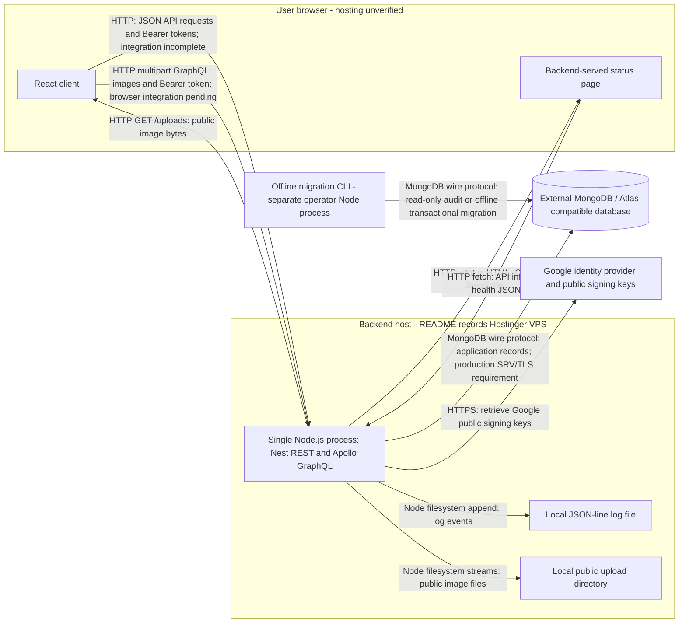

# MedConnect backend architecture

Source inspection date: 2026-10-15; uploader update: 2026-10-18 (Asia/Seoul). This document describes the current implementation, not a verified live deployment. Paths below are relative to the repository root. This is the single architecture document for the backend, including component responsibilities, diagrams, integration status, and concerns.

## Purpose and structure

The backend is a single NestJS application serving member authentication, public member profiles, appointment booking/lookup, and operational health endpoints. Feature modules run in the same Node.js process; they are not independent microservices. MongoDB stores application records and refresh sessions.

`backend/src/main.ts` loads environment configuration, validates startup requirements, configures validation/CORS/security headers/logging, exposes Swagger, and starts the HTTP server. `AppModule` imports GraphQL, database infrastructure, and `ComponentsModule`, which registers member, appointment, notification, health, upload, and internal booking coordination modules. Booking policy V2 was integrated October 25, 2026 (Asia/Seoul); writes require the activation flag and verified migration on a replica set.

| Layer | Responsibility | Source |
| --- | --- | --- |
| Transport | REST request handling and GraphQL arguments/context; delegate operations | `backend/src/components/member/member.controller.ts`, `member.resolver.ts`; `backend/src/components/appointment/appointment.controller.ts`, `appointment.resolver.ts` |
| Authentication | Verify Google credentials/browser nonce; resolve Bearer tokens to current member principals | `backend/src/components/auth/google-auth.service.ts`; `backend/src/components/auth/guards/member-access.guard.ts`; `backend/src/components/member/member.service.ts` |
| Application logic | Authentication/session lifecycle, profile projection, booking rules, participant access | `backend/src/components/member/member.service.ts`; `backend/src/components/appointment/appointment.service.ts` |
| Validation and contracts | Input validation, GraphQL output types, enums, shared TypeScript types | `backend/src/libs/dto/`, `backend/src/libs/enum/`, `backend/src/libs/types/` |
| Data access | Injected Mongoose models queried directly by feature services; no separate repository layer | `backend/src/schemas/`; feature services |
| Infrastructure | MongoDB connection/status, GraphQL configuration, logging | `backend/src/database/`, `backend/src/libs/graphql/`, `backend/src/libs/logger/`, `backend/src/libs/interceptor/` |

## Stack and technologies

Versions below are declared dependency ranges in [backend/package.json](../../backend/package.json), not claims about installed or production versions.

| Area | Technology | Use |
| --- | --- | --- |
| Runtime and language | Node.js; TypeScript `^6.0.2` | Node 24.12.0 is selected by the local Compose file. TypeScript targets ES2023 with NodeNext resolution; package format is CommonJS. |
| Server framework | NestJS `^12.0.1`, Express adapter | Dependency injection, modules, REST controllers, guards, pipes, interceptors |
| GraphQL | Nest GraphQL/Apollo `^14.0.0`, Apollo Server `^5.5.1`, GraphQL `^16.14.2` | Code-first schema generated in memory from DTO decorators at `/graphql` |
| Persistence | MongoDB driver `^7.6.0`, Mongoose `^9.10.0`, Nest Mongoose `^12.0.0` | MongoDB/Atlas-compatible connection, schemas, indexes, queries |
| Authentication | Nest JWT `^12.0.1`, `google-auth-library` `^11.3.0`, Node `crypto` | Google ID-token verification, HS256 access JWTs, salted scrypt passwords, random opaque refresh tokens and SHA-256 token hashes |
| Input handling | `class-validator` `^0.15.1`, `class-transformer` `^0.5.1` | Global validation/transform pipe and DTO rules |
| API documentation | Nest Swagger `^12.0.2` | REST UI at `/docs`, OpenAPI JSON at `/docs-json` |
| Abuse controls | `express-rate-limit` `^8.7.0` | In-memory auth request limits per process |
| Async execution and logs | RxJS `^7.8.1`, custom `FileLogger`, Node filesystem APIs | HTTP/GraphQL timing/error interception, JSON-line file logs and terminal output |
| Verification/tooling | Jest 30, ts-jest 29, Supertest 7, Nest CLI, Oxlint, Prettier | Unit/HTTP tests, compilation, linting, formatting; exact ranges are in package.json |
| Browser client context | React 18, Vite 5, TypeScript 5, React Router 6, Zustand 4, Axios 1, React Hook Form 7, Zod 3, Tailwind CSS 3 | Separate `frontend/` application; declarations are in `frontend/package.json`. Backend integration is incomplete. |

## Logical layers

```mermaid
flowchart TD
  UI[React pages and components]
  Session[React Router and Zustand session]
  Client[Axios API clients - integration incomplete]
  REST[Nest REST controllers]
  GQL[Apollo GraphQL resolvers]
  Guard[MemberAccessGuard - protected appointments, uploads and member edits]
  Upload[UploadService - public member and clinic images]
  Images[(Local upload directory)]
  Member[MemberService]
  Google[GoogleAuthService]
  Provider[Google Identity Services and signing keys]
  Booking[AppointmentService and slot helper]
  Notifications[NotificationService - in-app delivery and private inbox]
  Lifecycle[AppointmentWaitlistLifecycleService]
  Promotion[AppointmentPromotionService - gated polling]
  Commitments[AppointmentCommitmentService]
  Waitlist[WaitlistService]
  Coordination[BookingCoordinationService]
  Schedule[AppointmentScheduleService]
  Models[Mongoose models and schema constraints]
  DB[(MongoDB collections)]
  Health[Health controllers and DatabaseService]
  Logs[LoggingInterceptor and FileLogger]
  UI -->|In-process calls: navigation and session state| Session
  UI -->|In-process calls: auth payloads| Client
  Session -->|In-process read: access token| Client
  Client -->|HTTP REST: JSON and Bearer token; some paths mismatched| REST
  GQL -->|In-process context: appointment, upload or member edit Bearer token| Guard
  GQL -->|In-process call: validated upload streams and target| Upload
  Upload -->|Node filesystem streams: image bytes| Images
  REST -->|In-process request: appointment Bearer token| Guard
  Guard -->|In-process call: verify token and load principal| Member
  REST -->|In-process calls: signup, login, refresh| Member
  GQL -->|In-process call: public profile ID| Member
  GQL -->|In-process call: own-account update input and principal| Member
  Member -->|In-process call: claim new image and delete previous owned file after save| Upload
  REST -->|In-process call: issue sign-in nonce| Google
  Member -->|In-process call: verify Google ID token and browser nonce| Google
  Google -->|HTTPS: fetch public signing keys for local JWT verification| Provider
  REST -->|In-process calls: validated input and principal| Booking
  GQL -->|In-process calls: validated input and principal| Booking
  Member -->|Mongoose calls: member and session reads/writes| Models
  Booking -->|Mongoose calls: eligibility/hours reads, appointment and outbox writes| Models
  GQL -->|Public slots or guarded clinic schedule mutations| Schedule
  GQL -->|Guarded join, leave, replace| Commitments
  GQL -->|Scoped entry reads and counts| Waitlist
  GQL -->|Own inbox/read or operator aggregate status| Notifications
  Waitlist -->|Transactional notification intents| Notifications
  Notifications -->|Fenced delivery transaction and scoped inbox queries| Models
  Lifecycle -->|Current slot availability| Booking
  Lifecycle -->|Cutoff and expiry transitions| Waitlist
  Lifecycle -->|Doctor/patient/slot transactions| Coordination
  Promotion -->|Claim, fence and finish private release events| Models
  Promotion -->|FIFO head and terminal transitions| Waitlist
  Promotion -->|Eligibility and held-generation booking| Booking
  Promotion -->|Doctor, patient and slot transaction| Coordination
  Commitments -->|One transaction covering both commitments| Coordination
  Commitments -->|Validated booking and cancellation| Booking
  Commitments -->|Consent, FIFO, terminal transitions| Waitlist
  Booking -->|Fulfill own matching entry in transaction| Waitlist
  Waitlist -->|Mongoose session: waitlist records| Models
  Schedule -->|In-process doctor-scoped transaction callback| Coordination
  Schedule -->|Mongoose reads and schedule writes| Models
  Booking -->|In-process transaction callback: patient and slot scope| Coordination
  Coordination -->|Mongoose session: coordination gates and commitment ledger| Models
  Models -->|MongoDB wire protocol: documents, queries, indexes| DB
  Health -->|In-process calls: Mongoose connection state| Models
  REST -->|Interceptor events: route, duration, errors| Logs
  GQL -->|Interceptor events: operation field, duration, errors| Logs
```

External API clients can call REST or `POST /graphql` over HTTP using JSON and, for protected operations, a Bearer token. The checked-in frontend does not yet implement the complete GraphQL flow. Guards and DTO validation precede protected service execution; the arrows show dependencies rather than every lifecycle step. Logs are metadata/error output, not business payloads. Google ID-token verification is implemented on the backend; the browser Google button is pending. Email delivery is absent.

## APIs and request flows

There is no global `/api/v1` prefix. REST and GraphQL share the same HTTP server and feature services.

| Interface | Operation | Access and implementation |
| --- | --- | --- |
| REST | `POST /member/signup`, `/member/login`, `/member/refresh` | Public authentication endpoints with validation and auth rate limiting; `MemberController` → `MemberService` |
| REST | `POST /member/google/nonce`, `/member/google/login` | Public, rate-limited nonce issuance and Google login/automatic USER registration; GoogleAuthService verifies identity, MemberService owns persistence and sessions |
| GraphQL | `getMember(id: ID!)` at `POST /graphql` | Public allowlisted active USER/DOCTOR/CLINIC profile; `MemberResolver` → `MemberService` |
| GraphQL | `getDoctors` at `POST /graphql` | Public active, approved, nondeleted doctors; shared public-field projection, name/ID ordering, maximum 100; `MemberResolver` → `MemberService.listDoctors` |
| GraphQL | `bookAppointment(input)`, `getAppointment(id)`, `myAppointments(input)` | Bearer authentication via `MemberAccessGuard`; delegates to `AppointmentService` |
| GraphQL | `createClinicAppointment`, `cancelAppointment`, `setAppointmentOutcome` | Guarded actor/participant permissions; shared AppointmentService rules and transactional outbox |
| GraphQL | `getAvailableSlots`, `setDoctorWeeklyHours`, `setDoctorDateOverrides` | Public bounded slot reads; own-clinic guarded schedule writes |
| GraphQL | `myClinicDoctors`, `reviewDoctorAffiliation` | Own-clinic affiliation discovery/review through MemberService |
| REST | `POST /appointment/bookAppointment`, `GET /appointment/:id` | Same guard and appointment service as GraphQL |
| Operations | `GET /`, `/health/live`, `/health/ready`, `/status` | Public API info, liveness, database readiness, and status UI; `/status/assets/*` serves its CSS/JS |

**Authentication:** signup validates public role/input fields, hashes the password, creates a member, and issues tokens. Doctors require an active clinic and start with PENDING affiliation; ADMIN is excluded from public signup. Login verifies email/password credentials and account status. Access JWTs last 15 minutes. Refresh tokens have a fixed seven-day session lifetime; only their hashes are persisted. Refresh atomically replaces the stored hash, so a token can be consumed once; rotation does not extend session expiry. There is no implemented logout/revocation endpoint.

**Google sign-in:** the browser first requests a five-minute signed nonce from `/member/google/nonce`, which also sets an HttpOnly cookie. It passes that nonce to Google Identity Services and posts the resulting ID token to `/member/google/login` with credentials included. GoogleAuthService validates the challenge and Google's signature/audience/issuer/expiry and checks the ID-token nonce against the cookie. Production uses a Secure, host-only cookie; successful login clears it. MemberService finds by Google `sub` or immediately creates an active USER, omitting phone/password. The provider name supplies a trimmed/truncated nickname; missing names/collisions use `google_user` plus six random digits, retried against the unique index. Only verified provider email is copied. Existing account profile/role remains unchanged. Email conflicts return 409 without automatic linking; inactive accounts are rejected. The service reuses normal access/refresh issuance. GOOGLE_CLIENT_ID is required for this flow; GOOGLE_CLIENT_SECRET is not consumed. Frontend Google sign-in integration remains pending.

**Protected requests:** the guard extracts REST or GraphQL request context and calls `MemberService.authenticateAccessToken`. JWT algorithm, issuer, audience, expiry, token type, and subject are checked. A fresh member query determines active status and current role. Services then enforce operation-specific authorization; a token alone does not grant appointment access.

**Booking:** the authenticated caller must be USER; patient identity comes from the principal. With BOOKING_POLICY_V2_ENABLED=true and verified migration, AppointmentService rechecks the active patient/auth version, doctor/clinic approval, selected specialty, clinic-local alignment and hours/overrides within a BookingCoordinationService transaction. It saves a CONFIRMED appointment with source ONLINE, specialty and opaque version together with its active ledger entry. Whole-patient serialization enforces the sliding 24-hour rule at one clinic/specialty across doctors and appointment overlap prevention everywhere. Doctor-slot gates plus the unchanged unique active-slot index prevent double allocation. New requests require specialty; old PENDING records are never silently confirmed. Disabled booking returns 503 rather than falling back to old writes.

**Appointment lookup:** the service scopes the query to the caller's patient, doctor, or clinic ID. Another doctor in the same clinic has no access; there is no ADMIN override. Missing and unauthorized appointments both return not found. Public member lookup is separate and returns only projected profile fields; it does not require this guard.

GraphQL errors are returned in an `errors` array, potentially with HTTP 200. `backend/src/libs/graphql/graphql.config.ts` maps application errors to codes, suppresses internal details, disables batched requests, and enables GraphiQL/introspection only outside production. Auth and appointment responses, and GraphQL responses, use `Cache-Control: no-store`.

## Data stores and ownership

| MongoDB collection | Data | Current owner/access |
| --- | --- | --- |
| `members` | USER, DOCTOR, CLINIC, ADMIN accounts, clinic timezone, affiliation and profile data | MemberService owns accounts/authentication/profile/affiliation writes; appointment services read eligibility |
| `member_sessions` | Member ID, refresh-token hash, expiry | MemberService writes and rotates sessions; unique hash and TTL expiry index |
| `appointments` | Participant IDs, booked specialty, source/version, UTC start/end, status, cancellation/change-request fields | AppointmentService creates confirmed bookings/reads participants; partial unique doctor/start index still includes legacy PENDING/CONFIRMED |
| `booking_gates` | Durable patient/doctor-slot revision rows; slot generation and allocation-pending state | BookingCoordinationService; transaction writes serialize competing operations; no TTL |
| `booking_commitments` | Active appointment/waitlist references, participants, recorded specialty, version/status and time interval | BookingCoordinationService; appointment entries saved atomically by public booking, legacy entries populated by migration |
| `appointment_events` | Durable status/release/booking-notice outbox, generation, fenced leases, retry/result fields | AppointmentService writes lifecycle events; AppointmentPromotionService claims releases and writes booking notices transactionally; no public event API; Step 8 emits separate in-app delivery intents |
| `waitlists` | Exact slot/specialty, consent evidence, FIFO sequence, status/version and fulfilled appointment reference | WaitlistService owns enrollment/closure and scoped reads; promotion uses its transaction methods |
| `waitlist_cleanup` | Slot sequence high-water marks for pending queue expiry | WaitlistService records atomically with booking; lifecycle worker closes old entries under their patient locks |
| `notification_outbox` | Deduplicated event/recipient/channel intents and claim/retry state | NotificationService; feature transactions emit intents, separate worker delivers |
| `notifications` | Private in-app message references and read state | NotificationService; patient-owned inbox/read API, no public collection access |
| `booking_policy` | Migration version/readiness marker | BookingMigrationService writes offline; BookingPolicyService checks at startup and in mutation transactions |
| `booking_migration_audit` | Metadata/status change history and review evidence references | Offline migration only; excluded from API projections and console/app logs |
| `doctor_availability` | Weekly doctor/clinic hours | AppointmentScheduleService owns writes; booking/slot reads share the slot helper |
| `doctor_availability_overrides` | Date-specific custom hours and unavailable intervals | AppointmentScheduleService owns writes; booking/slot reads share the slot helper |

Schemas are in `backend/src/schemas/`. References are MongoDB ObjectIds; appointment operations do not populate related member records. Cancellation/outcome APIs are implemented; embedded doctor change-request fields still do not establish a rescheduling API. MemberService owns pending doctor affiliation review; AppointmentScheduleService owns clinic-scoped schedule writes. These now have guarded GraphQL APIs. MemberModule exports MemberService and MemberAccessGuard. AppointmentModule imports that public interface for authentication while separately registering member models for its direct reads.

### Booking transaction foundations (Steps 2–3)

`backend/src/components/booking/booking-coordination.service.ts` exports `run(scope,
callback)` through BookingModule. The scope declares every affected patient and
doctor-slot up front. A whole-patient gate deliberately serializes all of that
patient's writes: this protects both the patient/clinic/specialty sliding 24-hour
check and appointment overlap across clinics/specialties. It is stronger and
coarser than separate specialty locks. All callbacks must lock the complete scope
before any authoritative business reads, use the supplied session on every write,
and await operations sequentially. Discovering another participant requires a
new transaction with an expanded scope, never a late out-of-order lock.
Callers must validate slots through `appointment-slot.ts` in the clinic timezone
and recheck authorization, doctor eligibility, schedule, cutoff and consent in the
transaction. Coordination is not a replacement for those domain checks.

The service seeds empty coordination rows outside the transaction, then writes
their revisions inside it in sorted key order: doctor IDs, patient IDs, then
doctor-slot keys. Booking and schedule edits both take the doctor gate. Concurrent writers therefore conflict on an actual document instead of
both passing a snapshot read. There is no expiring application lock or lock TTL.
The driver retries transient failures with a 10-second transaction deadline and
at most eight callback executions; commit time is limited to five seconds. Reads
use snapshot isolation, writes majority concern, and primary preference. Unknown
commit outcomes must be reconciled before callers retry a user action. Callback
code must not send notifications, perform filesystem/network side effects, or
manually commit/abort; persist future outbox events in the supplied transaction.

`reserve` checks the active ledger for specialty spacing, patient overlap and
doctor occupancy. `release` removes a commitment under its patient/slot locks.
`holdSlot` increments a generation and prevents manual reservation until allocation
is resolved; allocator reservations and `resolveSlot` require the expected
generation. Generation checks provide the shared concurrency foundation; Step 7 adds FIFO
processing above it, while notification delivery remains separate. Domain records
and their ledger entries are created/changed atomically by booking, lifecycle,
waitlist and replacement services. Historical appointments enter the ledger
only through explicit offline migration before policy V2 is enabled. The existing appointment unique active
doctor/start index is unchanged.

The service refuses missing persistence and standalone MongoDB before executing a
callback. Replica-set, transaction and deployment guidance follows the
[MongoDB transaction documentation](https://www.mongodb.com/docs/drivers/node/current/crud/transactions/).
`npm run test:booking:integration` owns temporary local MongoDB processes and tests
real two-client races, failure rollback, retries, slot generations, unique indexes
and standalone rejection. This does not establish Atlas deployment readiness or
production queue operation. Public enrollment/replacement is covered below.

### Activation, migration and conflict responses (Step 3)

BookingPolicyService verifies the enabled flag, replica-set/index prerequisites,
readiness marker and a consistent transactional snapshot of metadata/ledger coverage
at startup. Every booking rechecks the marker in its transaction. The operator
must stop all old/new writers for migration; a CLI acknowledgment cannot enforce
another process's shutdown. Never run old writers after cutover or bypass the
ledger with external status edits. Cancellation/outcomes update ledger and version
atomically; replacements and waitlist writes follow the same protocol.

`backend/src/tools/booking-migration.ts` uses the shared URI selector and a
connection with automatic DDL disabled. Dry-run reads only and emits aggregate
counts; an optional exclusive mode-0600 operator report contains record IDs/issues.
BookingMigrationService applies reviewed resolutions, backfills source/version and
known specialty, preserves terminal history with nullable specialty, rebuilds the
active ledger and marks readiness atomically. PENDING/ambiguous/conflicting or stale
active records block migration; the current doctor specialty list is never used
as historical inference. Each actual metadata/status change records audit evidence;
unchanged reruns preserve versions and add no audit entries. Failure rolls back
all document changes, while index preparation precedes the transaction. This
initial tool is bounded to 5000 appointments and refuses any waitlist records or commitments.
The exact commands and resolution shape are in the root README. No application
DB migration, backup rehearsal, Atlas cutover or production activation was run.

BookingConflictException constructs only allowlisted summaries from a query scoped
to the requesting patient. Both transports expose reason, own commitments and
choices; GraphQL keeps its generic extensions.code and adds extensions.booking
only for the explicit booking exception classes. Other HttpException payloads
are not forwarded. KEEP is offered for own conflicts; REPLACE is additionally offered when enabled
for a single future replaceable blocker. Slot conflicts expose no other patient's identity. Source,
specialty and version are added to participant appointment reads; no generic
status mutation or notification worker is introduced.

### Clinic schedules and dynamic slots (Step 4, October 26)

MemberService exposes own-clinic doctor discovery and conditional PENDING affiliation
approval/rejection; approved affiliations cannot be revoked through that operation.
AppointmentScheduleService replaces weekly hours or one date's overrides inside
a doctor-gated transaction, verifies clinic ownership/current account state and
checks future/in-progress appointments plus active waitlist ledger targets before
narrowing hours. Invalidating edits conflict without changing those commitments.
Booking takes the same doctor gate before schedule reads, preventing write races.
Later worker allocation paths must also include the doctor gate.

The public getAvailableSlots query requires an active clinic, approved doctor and
offered specialty, and caps inclusive clinic-local date ranges at 31 days. Shared
appointment-slot.ts helpers generate real UTC instants, preserve local :00/:30
alignment through DST/quarter-hour offsets, and apply weekly/custom/blocked hours.
Occupancy reads project only time intervals; allocation holds become UNAVAILABLE.
No empty slot documents or fixed time enum are introduced. Slot policy eligibility
for waitlisting is distinct from actual enrollment, which requires the Step 6 flag. Results are advisory; mutation-time checks remain authoritative. The
existing disposable API suite covers onboarding/configuration, split shifts,
overrides, privacy, ownership, preserved commitments and concurrent booking/editing.
No browser integration, application DB changes or deployment was performed.

### Waitlists and atomic replacements (Step 6, October 31)

WaitlistModule (imported by AppointmentModule) owns waitlists through WaitlistService:
consent, per-slot FIFO sequence, participant-scoped reads and terminal updates.
AppointmentCommitmentResolver delegates patient join/leave/replace operations to
AppointmentCommitmentService. That orchestrator calls explicit AppointmentService
transaction interfaces for schedule validation, occupied-slot checks, creation and
cancellation; it does not access another service's models or private helpers.

Both source/destination doctors, the patient and both slots are locked in the
existing order. Expected original versions prevent stale replacement. Appointment
cancellation, outbox events, waitlist withdrawal/enrollment and the ledger commit
or roll back together. New queue entries increment the slot gate's queueSequence;
withdrawal/rejoining never restores an old position. Patient overlap and specialty
spacing are enforced against all remaining commitments.

Booking fulfills only its own matching entry, in the booking transaction, without
resolving an allocation hold. It therefore cannot jump queued allocation. Last
withdrawal clears an otherwise stranded hold. Other patients' expiry is deferred
to workers so this writer never changes entries outside its patient scope.

WAITLIST_ENROLLMENT_ENABLED and COMMITMENT_REPLACEMENT_ENABLED default off and
validate their prerequisite flags. Disabling enrollment preserves reads/withdrawal.
Startup snapshot audit compares active appointment and waitlist metadata/ledger,
checks queue counters/ordering and combined specialty conflicts. The initial
migration continues to refuse all queues, including terminal history.

The Step 7 promotion and Step 8 lifecycle/delivery workers are described below. Outputs explicitly return
automaticBookingEnabled=false and compute cutoff eligibility; the lifecycle worker persists NOTIFICATION_ONLY/expiry transitions. Own patient/clinic
entry reads are allowlisted; clinics receive no FIFO position, doctors only scoped
aggregate counts. See root README for GraphQL inputs, pagination and flag behavior.

### Cancellation, clinic booking and durable events (Step 5, October 28)

AppointmentService owns all new mutations. Clinic creation derives clinicId from
a current CLINIC principal, validates an existing active USER, and delegates to
the same private booking operation as online creation. Source/creator metadata
records PHONE/WALK_IN and the clinic actor. Staff conflict responses omit patient
commitment summaries, including other clinics' records.

Cancellation is patient/own-clinic only before start; completion/no-show is
own-clinic only at/after end. Each operation rechecks actor, scoped appointment and
state/time under doctor, patient and slot gates. A version-conditional write,
active ledger removal and durable outbox insert commit together. Repeated matching
terminal actions return the stored result without new events/generation changes.
Outbox initialization/indexing occurs before the transaction; failures inside it
roll back appointment, ledger, generation and events. Creation can be paused while
migrated commitments remain cancellable through assertMigrated.

Cancellation increments slot generation and writes SLOT_RELEASED plus a status
change event with stable IDs. A queue at >=48h retains the allocation hold;
manual openings release it. Closed/ineligible schedules produce UNAVAILABLE hints
and never bypass booking's schedule checks. Manual reservations increment the
generation to stale earlier releases. The promotion worker rechecks actual cutoff,
generation and current occupancy/schedule, rather than treating an event hint as
current availability. Outbox records are private and have no TTL. Step 7 adds
claims/retries; Step 8 adds in-app delivery. No application DB migration,
frontend integration or deployment was performed.

### FIFO promotion and durable claim recovery (Step 7, October 31)

`backend/src/components/appointment/appointment-promotion.service.ts` is an internal
AppointmentModule provider. It owns no transport route and uses the existing
appointment_events outbox. A bounded polling loop claims queue/unavailable release
events with a token, 30-second lease and attempt counter. Expired claims can be
reclaimed after restart. Each transaction writes the token fence after locking the
doctor/patient/slot, so a stale owner cannot book after takeover. Slot generation
checks prevent old releases from touching a newer hold.

WaitlistService selects the FIFO ACTIVE head and performs version-conditional
INELIGIBLE/fulfilled transitions; notification-only entries are excluded.
AppointmentService checks current consent/patient/doctor/clinic/schedule eligibility.
BookingCoordinationService exposes a read-only reservation preflight that excludes
only the selected waitlist, sharing specialty/overlap checks with actual reservation.
Only typed, established eligibility failures skip a patient; infrastructure failures
abort the transaction and retry the same head with bounded backoff. A claim handles
at most 25 candidates before yielding; empty eligible queues resolve their hold.

Promotion uses the existing booking transaction with source WAITLIST and the held
generation. Appointment creation, queue fulfillment, ledger changes, hold resolution,
WAITLIST_BOOKING_CREATED and release-event completion commit together. Cutoff checks
before and after writes roll back a booking that crosses inside 48 hours. A fenced
follow-up transaction releases the same generation and marks DEFERRED for Step 8;
manual-opening events are not consumed by this worker. Remaining queue expiry and
notification fan-out belong to Step 8.

Persisted claim/retry/result fields provide private failure visibility; poll failures
log only a fixed safe code. The worker stops polling and waits for its current poll
on shutdown. Tests use real MongoDB for worker contention, FIFO, rollback, abandoned
leases, fresh instances, stale-owner fencing and cutoff/withdrawal races. Actual
process-kill recovery and operational monitoring remain Step 12 validation.

WAITLIST_PROMOTION_ENABLED defaults off and rejects true while verified patient-visible
the patient-facing flow has not been browser-verified. Tests override internal enablement, not persistence or booking.
The worker is implemented but production activation awaits the verified patient-facing flow in Step 11; persisted
notification events alone do not satisfy delivery readiness. No application DB,
production configuration or hosting changes were made.

### Cutoff lifecycle and in-app delivery (Step 8, October 31)

NotificationModule owns notification_outbox and notifications through
`backend/src/components/notification/notification.service.ts`; WaitlistModule imports
its exported interface. AppointmentModule's AppointmentWaitlistLifecycleService
owns background coordination and uses public appointment/waitlist methods. This
keeps inbox/delivery independent of appointment creation and avoids a module cycle.
Notification transport is a guarded resolver with user-scoped pagination/read state
and ADMIN-only aggregate delivery counters. DTOs and Notice types remain under libs.

Cancellation writes recipient intents inside its transaction, capturing active
manual-opening recipients under the doctor/slot gate. Later delivery does not
reconstruct the original snapshot from changing queue state. Promotion's cutoff
handoff similarly writes manual-opening intents. The lifecycle worker also handles
manual/deferred events and queued holds reaching the cutoff when promotion is off;
current generation, occupancy and schedule checks prevent stale availability alerts.

Successful booking records a per-physical-slot sequence high-water mark in
waitlist_cleanup. Per-patient transactions expire the remaining old entries and
write expiry intents without a transaction spanning every patient. Newer enrollments
survive old jobs; entries pending cleanup are excluded from promotion/replacement.
Cutoff transitions update queue and ledger versions together; slot-start expiry
releases the commitment. Cleanup and delivery each process at most 25 units per
one-second poll and resume from durable data after restart.

NotificationService.emit upserts event/recipient/IN_APP delivery intents in the
caller's transaction. Its IN_APP adapter separately claims a token/30-second lease,
fences ownership, upserts a private inbox record and acknowledges delivery in one
MongoDB transaction. Failed delivery cannot change a booking; safe backoff metadata
and operator aggregate counters expose failures. No provider errors or contacts are
returned. Replay preserves read state. Hash notification IDs do not reveal the
source cancellation's other-patient appointment ID. Patient messages distinguish
an unreserved opening from a historical booking event and require current-state reads.

WAITLIST_LIFECYCLE_ENABLED and WAITLIST_NOTIFICATIONS_ENABLED independently default
off and require migrated replica-set persistence. Captured intents survive pauses;
lifecycle is independent of delivery availability. In-app API delivery, privacy,
deduplication and retry are tested against real MongoDB/HTTP. Browser inbox/link
integration is Step 11; external email/SMS adapters remain unconfigured. Promotion's
release gate remains closed until the patient-facing flow is verified. No real
application DB, runtime activation or deployment changed.

### Patient appointment list (Step 9 backend only, October 31)

AppointmentResolver exposes guarded myAppointments with MyAppointmentsInput and
AppointmentPage DTOs. AppointmentService derives patientId from the USER principal,
scopes both cursor lookup and result queries to that patient, reuses the appointment
projection and normalizes missing historical source to LEGACY. It accepts no target
patient identity. MemberAccessGuard continues to verify current role/status/token
version; GraphQL responses remain no-store.

The query caps pages at100 (default20), orders startsAt then _id ascending, and uses
an owned appointment ID as the cursor. Status and inclusive-from/exclusive-to UTC
filters support upcoming/history views. Time ties use _id to avoid skipped records;
status changes on the anchor do not invalidate an owned cursor. The new compound
patientId/startsAt/_id index supports the ordering. Reads do not require booking's
creation flag or migration marker, matching participant lookup behavior.

This supplies the missing backend list for the patient journey. Existing auth/refresh,
slots, booking, waitlist and replacement APIs remain unchanged. Per user direction,
frontend work for Steps9–12 is deferred; no Next.js/Vite files or session behavior
are changed. Browser integration remains unverified and the promotion release gate
remains closed. The next implementation scope is Step10's backend portion.

## Shared services and external integrations

Here, shared services include reusable in-process capabilities and external providers. An installed package or schema field alone does not establish a working integration.

| Capability/provider | Status | Boundary and evidence |
| --- | --- | --- |
| Email/password identity | Implemented internally | MemberService, JWT module, password helper, and MemberAccessGuard. An email address is a login identifier; no email is sent. |
| Google sign-in | Backend implemented; browser integration pending | GoogleAuthService uses google-auth-library and GOOGLE_CLIENT_ID. REST nonce/login endpoints verify the ID token and bind its nonce to a browser cookie. MemberService owns identity creation and app sessions; no Google client secret or code exchange is used. Explicit account linking is not implemented. |
| Telegram identity | Schema support only | `telegramId` exists; no implemented Telegram login flow. |
| Email delivery | Not implemented; provider unselected | No mail adapter/SDK, SMTP transport, verification email, or appointment notification sender found in backend source/dependencies. |
| MongoDB / Atlas | Persistence integration implemented | Mongoose connection through DatabaseModule. Production startup requires a `mongodb+srv://` URI; live Atlas connectivity/index behavior was not checked for this document. |
| External medical, pharmacy, maps, or payment APIs | No implemented integration found | No outbound business HTTP client/service found in backend source. Do not present these as existing capabilities. |
| Logging | Implemented internally | FileLogger writes JSON lines to `LOG_FILE` or `logs/medconnect.log`; LoggingInterceptor records transport execution metadata. No hosted log service is configured in this code. |
| Health monitoring | Implemented internally | DatabaseService supplies connection status; `/status` polls this application's JSON endpoints using browser fetch. No external monitoring provider is established. |
| Cache, queue, scheduler, batch service | Not implemented | No Redis/shared rate-limit store, mail queue, or batch runtime wired into AppModule. |

Google verification is behind GoogleAuthService; account/session writes remain in MemberService. When adding email or another external API, keep provider SDK calls and credentials behind a backend adapter/service. Expose explicit application methods to features, define who owns identity/notification data, and document failure/retry behavior. Email and additional external API adapters are proposed boundaries, not existing components.

## Clinic and doctor cities

As of 2026-10-18, clinic signup requires `location` from MediBridge's ten-value
`Location` enum in `backend/src/libs/enum/location.enum.ts`. SignupDto and
MemberService validate required clinic cities; the service rejects location supplied
by doctors/users, and the Mongoose schema requires city storage on clinics only.
Doctors select `clinicId` at signup and never store their own city.

MemberService hydrates the location response field from each doctor's current active,
nondeleted clinic for getMember, getDoctors, and signup/login/refresh. The directory
uses one batched clinic query, selecting only clinic ID and location. Existing stored
doctor cities are ignored. Changing clinicId or the clinic city affects the next read;
there is no city cache or duplicate city value to synchronize. A missing/unavailable
clinic or legacy clinic without a city yields an absent city (GraphQL null). Clinic
responses use the clinic's stored city; USER responses do not expose legacy city data.

Clinics can edit their city through updateMember; doctor responses reflect it on the
next read. No migration, workplace-change endpoint, or directory city filter
is implemented. Tests change simulated persistence to verify affiliation/city changes;
no live database or frontend workplace-change workflow was exercised.

## Authenticated member updates

`MemberResolver.myProfile(): MemberSelf!` is a guarded read for settings pages.
It takes no target ID: MemberService reads the authenticated member's active,
nondeleted record, rechecks authVersion, selects an explicit profile/contact allowlist,
and hydrates doctor city from the current clinic. A shared selfProfile mapper supplies
both this query and updateMember.member. Only MemberSelf exposes email/phone and
canChangePassword (EMAIL provider); public Member schema/projections are unchanged.
The capability flag is a UI hint; updateMember retains server-side enforcement.
No password hash/provider identifiers/authVersion are returned. Existing GraphQL
context sets no-store. Next.js may load settings with this query without expanding
its basic identity session. Actual frontend wiring remains outside this backend task.

`MemberResolver.updateMember(input: MemberUpdateInput!)` uses MemberAccessGuard and
the authenticated principal, never a caller-supplied account ID. Input lives in
`backend/src/libs/dto/member/member-update.input.ts`; MemberService owns profile,
password, and session-version writes. The response is MemberUpdateResult with an
authenticated MemberSelf (private contact fields), requiresLogin, and
imageCleanupPending. Public Member fields remain unchanged.

Allowed edits are name, nickname, phone, image, address and description; clinic name
and city are clinic-only. Affiliation, approval, email/provider and role/status changes
are outside this API. Password changes require currentPassword, newPassword and
confirmPassword together, matching confirmation, existing length constraints and
successful current-password verification. Google-only accounts cannot set a password.
Only the new salted hash persists; logging excludes arguments and response data.

All requested member changes use one conditional findOneAndUpdate with explicit
allowlisted $set fields, runValidators, and an incremented __v. Snapshot/version
conflicts and unique-index collisions return CONFLICT. The clinic-city schema validator
reads the trusted memberType filter when running in Mongoose query context.
Password changes also atomically increment hidden member authVersion; signed access
tokens and refresh-session records carry the version. Current-member guard/refresh
checks reject mismatches, including outstanding tokens/sessions. Missing legacy
versions mean zero. The frontend must sign in again when requiresLogin is true.

Image writes remain owned by UploadService. UploadStorageModule exports storage to
MemberModule and UploadModule without an authentication dependency/circular import.
Uploads use authenticated owner directories. Before saving, MemberService claims an
owned pending image with an exclusive hidden attachment marker. Conditional-write
failures release the marker when the failure is known; uncertain database outcomes
retain it for later reconciliation. A successful database write precedes deletion of
the old owned attached file. Markers remain after deletion to prevent reattachment
races. External/unowned legacy files are never deleted. Failed deletion preserves
the successful update and sets imageCleanupPending; no automatic retry exists.
Pending uploads, orphan claims, and retired markers await the deferred cleanup tool.

Update/ownership/concurrency/session tests use real GraphQL, Mongoose document
validation, password helpers and filesystem operations with simulated database writes.
Actual MongoDB concurrent writes/indexes, browser Save integration and deployment
remain unverified.

## Public image uploads

`UploadModule` imports `MemberModule` for its exported access guard and
`UploadStorageModule` for filesystem operations. `UploadResolver`
exposes MediBridge-compatible `imageUploader(file: Upload!, target: String!): String!`
and `imagesUploader(files: [Upload!]!, target: String!): [String!]!` mutations.
`MemberAccessGuard` verifies the token and current account through `MemberService`;
`UploadService` owns file writes and has no MongoDB/profile write responsibility.
`upload.http.ts` registers graphql-upload-ts multipart middleware at `/graphql`
and Express static serving at `/uploads`; `main.ts` calls it before listening.

Targets are restricted to member/clinic images, stored below authenticated owner IDs.
UploadService generates UUID names,
checks MIME types and PNG/JPEG/WebP signatures, streams to hidden temporary files,
then publishes by rename. Limits are 10 MB/file and five files/request; failed writes
and batches are cleaned up. Apollo CSRF protection stays enabled; clients send
`Apollo-Require-Preflight: true`, which is allowed by CORS. These are public images,
not protected medical documents. Signatures are checked without full decoding or
malware scanning. `UPLOAD_DIR` defaults to `uploads` relative to the backend working
directory. Save-time deletion of previously attached owned profile images is implemented;
persistent disk provisioning, quotas, unused-file cleanup/retry jobs, object storage,
and browser/profile editing integration remain unimplemented.

Upload HTTP tests use real multipart parsing and disk writes with mocked current-member
authentication. No live MongoDB or deployment was exercised for this addition.

## Security and configuration

The global ValidationPipe transforms DTO inputs and rejects unknown fields. CORS allows configured browser origins; it is not authentication. Passwords, JWT secrets, database credentials, raw refresh tokens, and private patient data must stay out of frontend code and logs. Member/auth responses use explicit allowlists; appointment reads use projections. The logging interceptor excludes bodies, tokens, GraphQL arguments/query text, and response data, but records request paths and exception messages/stacks; this is not a universal redaction service.

Auth endpoints share a 20-request/minute/IP/process limiter. It is not a distributed abuse-control system and does not cover every query. Public profile access and its projected fields must be considered when changing privacy requirements.

| Configuration name | Purpose / current behavior |
| --- | --- |
| `JWT_ACCESS_SECRET` | Server-only signing key for access JWTs and Google nonce challenges; startup requires at least 32 bytes |
| `GOOGLE_CLIENT_ID` | Google web client audience; absence disables Google endpoints with 503. GOOGLE_CLIENT_SECRET is unused by this ID-token flow. |
| `MONGO_URI`, `MONGO_DEV`, `MONGO_PROD`, `NODE_ENV` | Shared database.config.ts selector: explicit MONGO_URI, then MONGO_PROD in production or MONGO_DEV otherwise. Startup validates the same selection; production requires SRV. |
| `BOOKING_POLICY_V2_ENABLED` | Exactly true/false; defaults false. Booking writes require true plus verified migration on a replica set; disabled never restores old writes. |
| `PORT_API`, `PORT` | Listener precedence: PORT_API, then PORT, then 3000. README examples use 3333. |
| `CORS_ORIGINS` | Comma-separated origin allowlist; defaults include localhost ports 3000 and 5173 |
| `LOG_FILE` | Optional JSON-line log file location |

Environment values are intentionally omitted. The application loads `.env` relative to its working directory before dynamically importing AppModule.

## Deployment

No live deployment was inspected. Browser/backend HTTP transport is shown as implemented/recorded; a production TLS terminator is not established by repository code. The local Compose file proposes a Node 24.12.0 container, PORT_API mapping, and external Docker network, but its npm working directory is inconsistent with the repository. It is not shown as a verified running container. Google public-key retrieval is wired in backend code; live provider calls were not verified. Email providers, batch processes, queues, and hosted monitoring are not deployed components established by this source inspection.
## Deployment and verification limits

The [deployment diagram](#deployment) separates the browser, Node/Nest process, and external database. The README records a Hostinger VPS backend deployment; this documentation task did not contact it or verify the installed runtime, proxy, TLS, frontend hosting, or database.

The backend's production scripts build with `npm run build` and start with `npm run start:prod` from `backend/`. Local ignored `docker-compose.yml` selects `node:24.12.0` and binds PORT_API, but runs npm from the repository root, where no package.json exists. `deploy.sh` hard-resets the checkout and selects `master`. These files require reconciliation before being treated as a repeatable deployment procedure; they were inspected, not executed or changed.

Tests under `backend/test/` exercise HTTP/GraphQL behavior with simulated persistence; unit tests include slot calculation. Google authentication tests exercise the real token-verification library using locally signed RSA tokens and a substituted public-key fetch; persistence is simulated. Live Google/browser authentication, actual MongoDB race/index enforcement, and email delivery were not exercised. Frontend screens still include mock authentication and conflicting API clients/contracts; their existence does not demonstrate working backend integration.

## Architecture concerns

These scoped source observations are not a full runtime/security audit. Database URI selection was corrected in Step 2; other findings below remain proposals.

| Finding and evidence | Impact | Proposed fix |
| --- | --- | --- |
| Corrected October 25: startup, DatabaseModule, MemberModule, AppointmentModule and BookingModule use `backend/src/database/database.config.ts`. | Prevents connection/registration disagreement and development fallback in production. | Selection tests cover explicit overrides, production precedence and invalid/missing settings. Production connectivity remains unverified. |
| Frontend authentication crosses incompatible contracts: `frontend/src/pages/Login.tsx` always calls mockLogin; `frontend/src/lib/api.ts` uses `/login/` and `/auth/register`, while the backend controller uses `/member/login` and `/member/signup`. `frontend/src/api.ts` defines a second client; frontend email/password and user shapes also differ from backend memberEmail/memberPassword and member responses. | A local UI session can appear authenticated without a valid server token; real registration/login calls do not match the implemented API. | Trace callers, consolidate the active API boundary, map backend DTO/response fields explicitly, and gate mocks deliberately. Verify signup/login/protected requests against server contracts; keep backend guards authoritative. |
| Local deployment workflow does not match source layout: ignored root `docker-compose.yml` runs npm in `/usr/src/medconnect`, while package.json is under backend/. `deploy.sh` hard-resets and selects master. | The recorded script cannot be assumed to build this checkout and can discard local changes when run. | Review the intended branch/release workflow, point container commands at backend/, and replace destructive checkout handling with an explicit release procedure. Validate configuration/build before attempting deployment. |

Scheduling write ownership was established in Step 4: MemberService owns affiliation review and AppointmentScheduleService owns weekly/date schedule changes. AppointmentService retains explicit read dependencies and shares pure slot/override rules. No repository-wide service split was introduced.
