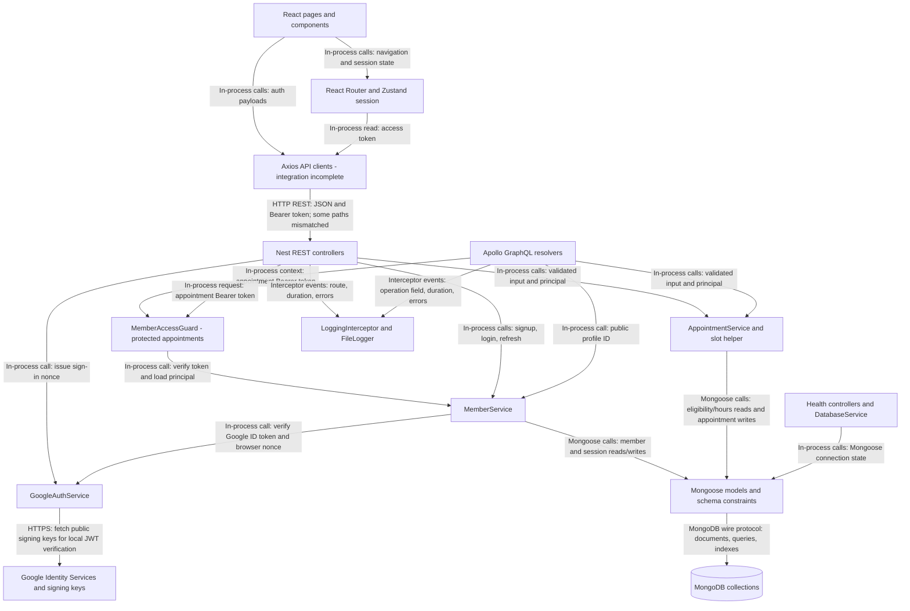
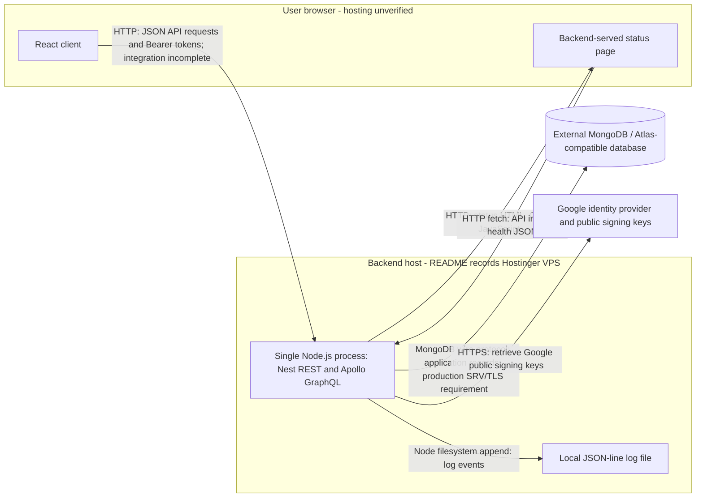

# MedConnect backend architecture

Source inspection date: 2026-10-15 (Asia/Seoul). This document describes the current implementation, not a verified live deployment. Paths below are relative to the repository root. This is the single architecture document for the backend, including component responsibilities, diagrams, integration status, and concerns.

## Purpose and structure

The backend is a single NestJS application serving member authentication, public member profiles, appointment booking/lookup, and operational health endpoints. Feature modules run in the same Node.js process; they are not independent microservices. MongoDB stores application records and refresh sessions.

`backend/src/main.ts` loads environment configuration, validates startup requirements, configures validation/CORS/security headers/logging, exposes Swagger, and starts the HTTP server. `AppModule` imports GraphQL, database infrastructure, and `ComponentsModule`, which registers member, appointment, and health modules.

| Layer | Responsibility | Source |
| --- | --- | --- |
| Transport | REST request handling and GraphQL arguments/context; delegate operations | `backend/src/components/member/member.controller.ts`, `member.resolver.ts`; `backend/src/components/appointment/appointment.controller.ts`, `appointment.resolver.ts` |
| Authentication | Verify Google credentials/browser nonce; resolve Bearer tokens to current member principals | `backend/src/components/auth/google-auth.service.ts`; `backend/src/components/auth/guards/member-access.guard.ts`; `backend/src/components/member/member.service.ts` |
| Application logic | Authentication/session lifecycle, profile projection, booking rules, participant access | `backend/src/components/member/member.service.ts`; `backend/src/components/appointment/appointment.service.ts` |
| Validation and contracts | Input validation, GraphQL output types, enums, shared TypeScript types | `backend/src/libs/dto/`, `backend/src/libs/enum/`, `backend/src/libs/types/` |
| Data access | Injected Mongoose models queried directly by feature services; no separate repository layer | `backend/src/schemas/`; feature services |
| Infrastructure | MongoDB connection/status, GraphQL configuration, logging | `backend/src/database/`, `backend/src/libs/graphql/`, `backend/src/libs/logger/`, `backend/src/libs/interceptor/` |

## Stack and technologies

Versions below are declared dependency ranges in [backend/package.json](../../backend/package.json), not claims about installed or production versions.

| Area | Technology | Use |
| --- | --- | --- |
| Runtime and language | Node.js; TypeScript `^6.0.2` | Node 24.12.0 is selected by the local Compose file. TypeScript targets ES2023 with NodeNext resolution; package format is CommonJS. |
| Server framework | NestJS `^12.0.1`, Express adapter | Dependency injection, modules, REST controllers, guards, pipes, interceptors |
| GraphQL | Nest GraphQL/Apollo `^14.0.0`, Apollo Server `^5.5.1`, GraphQL `^16.14.2` | Code-first schema generated in memory from DTO decorators at `/graphql` |
| Persistence | MongoDB driver `^7.6.0`, Mongoose `^9.10.0`, Nest Mongoose `^12.0.0` | MongoDB/Atlas-compatible connection, schemas, indexes, queries |
| Authentication | Nest JWT `^12.0.1`, `google-auth-library` `^11.3.0`, Node `crypto` | Google ID-token verification, HS256 access JWTs, salted scrypt passwords, random opaque refresh tokens and SHA-256 token hashes |
| Input handling | `class-validator` `^0.15.1`, `class-transformer` `^0.5.1` | Global validation/transform pipe and DTO rules |
| API documentation | Nest Swagger `^12.0.2` | REST UI at `/docs`, OpenAPI JSON at `/docs-json` |
| Abuse controls | `express-rate-limit` `^8.7.0` | In-memory auth request limits per process |
| Async execution and logs | RxJS `^7.8.1`, custom `FileLogger`, Node filesystem APIs | HTTP/GraphQL timing/error interception, JSON-line file logs and terminal output |
| Verification/tooling | Jest 30, ts-jest 29, Supertest 7, Nest CLI, Oxlint, Prettier | Unit/HTTP tests, compilation, linting, formatting; exact ranges are in package.json |
| Browser client context | React 18, Vite 5, TypeScript 5, React Router 6, Zustand 4, Axios 1, React Hook Form 7, Zod 3, Tailwind CSS 3 | Separate `frontend/` application; declarations are in `frontend/package.json`. Backend integration is incomplete. |

## Logical layers

External API clients can call REST or `POST /graphql` over HTTP using JSON and, for protected operations, a Bearer token. The checked-in frontend does not yet implement the complete GraphQL flow. Guards and DTO validation precede protected service execution; the arrows show dependencies rather than every lifecycle step. Logs are metadata/error output, not business payloads. Google ID-token verification is implemented on the backend; the browser Google button is pending. Email delivery is absent.

## APIs and request flows

There is no global `/api/v1` prefix. REST and GraphQL share the same HTTP server and feature services.

| Interface | Operation | Access and implementation |
| --- | --- | --- |
| REST | `POST /member/signup`, `/member/login`, `/member/refresh` | Public authentication endpoints with validation and auth rate limiting; `MemberController` → `MemberService` |
| REST | `POST /member/google/nonce`, `/member/google/login` | Public, rate-limited nonce issuance and Google login/automatic USER registration; GoogleAuthService verifies identity, MemberService owns persistence and sessions |
| GraphQL | `getMember(id: ID!)` at `POST /graphql` | Public allowlisted active USER/DOCTOR/CLINIC profile; `MemberResolver` → `MemberService` |
| GraphQL | `bookAppointment(input)`, `getAppointment(id)` | Bearer authentication via `MemberAccessGuard`; delegates to `AppointmentService` |
| REST | `POST /appointment/bookAppointment`, `GET /appointment/:id` | Same guard and appointment service as GraphQL |
| Operations | `GET /`, `/health/live`, `/health/ready`, `/status` | Public API info, liveness, database readiness, and status UI; `/status/assets/*` serves its CSS/JS |

**Authentication:** signup validates public role/input fields, hashes the password, creates a member, and issues tokens. Doctors require an active clinic and start with PENDING affiliation; ADMIN is excluded from public signup. Login verifies email/password credentials and account status. Access JWTs last 15 minutes. Refresh tokens have a fixed seven-day session lifetime; only their hashes are persisted. Refresh atomically replaces the stored hash, so a token can be consumed once; rotation does not extend session expiry. There is no implemented logout/revocation endpoint.

**Google sign-in:** the browser first requests a five-minute signed nonce from `/member/google/nonce`, which also sets an HttpOnly cookie. It passes that nonce to Google Identity Services and posts the resulting ID token to `/member/google/login` with credentials included. GoogleAuthService validates the challenge and Google's signature/audience/issuer/expiry and checks the ID-token nonce against the cookie. Production uses a Secure, host-only cookie; successful login clears it. MemberService finds by Google `sub` or immediately creates an active USER, omitting phone/password. The provider name supplies a trimmed/truncated nickname; missing names/collisions use `google_user` plus six random digits, retried against the unique index. Only verified provider email is copied. Existing account profile/role remains unchanged. Email conflicts return 409 without automatic linking; inactive accounts are rejected. The service reuses normal access/refresh issuance. GOOGLE_CLIENT_ID is required for this flow; GOOGLE_CLIENT_SECRET is not consumed. Frontend Google sign-in integration remains pending.

**Protected requests:** the guard extracts REST or GraphQL request context and calls `MemberService.authenticateAccessToken`. JWT algorithm, issuer, audience, expiry, token type, and subject are checked. A fresh member query determines active status and current role. Services then enforce operation-specific authorization; a token alone does not grant appointment access.

**Booking:** the authenticated caller must be USER; patient identity comes from the principal. `AppointmentService` checks the active doctor/clinic relationship and APPROVED affiliation, derives a 30-minute slot in the clinic timezone using `appointment-slot.ts`, applies weekly hours/date overrides, and checks overlap. It awaits model initialization and uses a unique active-slot index to resolve simultaneous same-start bookings. PENDING/CONFIRMED appointments reserve the slot. Patient conflicts across different doctors are not prevented.

**Appointment lookup:** the service scopes the query to the caller's patient, doctor, or clinic ID. Another doctor in the same clinic has no access; there is no ADMIN override. Missing and unauthorized appointments both return not found. Public member lookup is separate and returns only projected profile fields; it does not require this guard.

GraphQL errors are returned in an `errors` array, potentially with HTTP 200. `backend/src/libs/graphql/graphql.config.ts` maps application errors to codes, suppresses internal details, disables batched requests, and enables GraphiQL/introspection only outside production. Auth and appointment responses, and GraphQL responses, use `Cache-Control: no-store`.

## Data stores and ownership

| MongoDB collection | Data | Current owner/access |
| --- | --- | --- |
| `members` | USER, DOCTOR, CLINIC, ADMIN accounts, clinic timezone, affiliation and profile data | MemberService creates accounts/authenticates/reads profiles; AppointmentService directly reads doctor and clinic eligibility |
| `member_sessions` | Member ID, refresh-token hash, expiry | MemberService writes and rotates sessions; unique hash and TTL expiry index |
| `appointments` | Participant IDs, UTC start/end, status, cancellation/change-request fields | AppointmentService creates/reads bookings; partial unique doctor/start index for PENDING/CONFIRMED |
| `doctor_availability` | Weekly doctor/clinic hours | Read by AppointmentService; no management API implemented |
| `doctor_availability_overrides` | Date-specific custom hours and unavailable intervals | Read by AppointmentService; no management API implemented |

Schemas are in `backend/src/schemas/`. References are MongoDB ObjectIds; appointment operations do not populate related member records. Change/cancellation schema fields do not mean change/cancellation APIs are implemented. Availability and approval currently require configuration outside the delivered API; their future write boundary remains to be defined. MemberModule exports MemberService and MemberAccessGuard. AppointmentModule imports that public interface for authentication while separately registering member models for its direct reads.

## Shared services and external integrations

Here, shared services include reusable in-process capabilities and external providers. An installed package or schema field alone does not establish a working integration.

| Capability/provider | Status | Boundary and evidence |
| --- | --- | --- |
| Email/password identity | Implemented internally | MemberService, JWT module, password helper, and MemberAccessGuard. An email address is a login identifier; no email is sent. |
| Google sign-in | Backend implemented; browser integration pending | GoogleAuthService uses google-auth-library and GOOGLE_CLIENT_ID. REST nonce/login endpoints verify the ID token and bind its nonce to a browser cookie. MemberService owns identity creation and app sessions; no Google client secret or code exchange is used. Explicit account linking is not implemented. |
| Telegram identity | Schema support only | `telegramId` exists; no implemented Telegram login flow. |
| Email delivery | Not implemented; provider unselected | No mail adapter/SDK, SMTP transport, verification email, or appointment notification sender found in backend source/dependencies. |
| MongoDB / Atlas | Persistence integration implemented | Mongoose connection through DatabaseModule. Production startup requires a `mongodb+srv://` URI; live Atlas connectivity/index behavior was not checked for this document. |
| External medical, pharmacy, maps, or payment APIs | No implemented integration found | No outbound business HTTP client/service found in backend source. Do not present these as existing capabilities. |
| Logging | Implemented internally | FileLogger writes JSON lines to `LOG_FILE` or `logs/medconnect.log`; LoggingInterceptor records transport execution metadata. No hosted log service is configured in this code. |
| Health monitoring | Implemented internally | DatabaseService supplies connection status; `/status` polls this application's JSON endpoints using browser fetch. No external monitoring provider is established. |
| Cache, queue, scheduler, batch service | Not implemented | No Redis/shared rate-limit store, mail queue, or batch runtime wired into AppModule. |

Google verification is behind GoogleAuthService; account/session writes remain in MemberService. When adding email or another external API, keep provider SDK calls and credentials behind a backend adapter/service. Expose explicit application methods to features, define who owns identity/notification data, and document failure/retry behavior. Email and additional external API adapters are proposed boundaries, not existing components.

## Security and configuration

The global ValidationPipe transforms DTO inputs and rejects unknown fields. CORS allows configured browser origins; it is not authentication. Passwords, JWT secrets, database credentials, raw refresh tokens, and private patient data must stay out of frontend code and logs. Member/auth responses use explicit allowlists; appointment reads use projections. The logging interceptor excludes bodies, tokens, GraphQL arguments/query text, and response data, but records request paths and exception messages/stacks; this is not a universal redaction service.

Auth endpoints share a 20-request/minute/IP/process limiter. It is not a distributed abuse-control system and does not cover every query. Public profile access and its projected fields must be considered when changing privacy requirements.

| Configuration name | Purpose / current behavior |
| --- | --- |
| `JWT_ACCESS_SECRET` | Server-only signing key for access JWTs and Google nonce challenges; startup requires at least 32 bytes |
| `GOOGLE_CLIENT_ID` | Google web client audience; absence disables Google endpoints with 503. GOOGLE_CLIENT_SECRET is unused by this ID-token flow. |
| `MONGO_URI`, `MONGO_DEV`, `MONGO_PROD`, `NODE_ENV` | Startup and feature modules prefer MONGO_URI, then the environment-specific URI. DatabaseModule currently instead prefers MONGO_DEV and ignores MONGO_URI; see critique. |
| `PORT_API`, `PORT` | Listener precedence: PORT_API, then PORT, then 3000. README examples use 3333. |
| `CORS_ORIGINS` | Comma-separated origin allowlist; defaults include localhost ports 3000 and 5173 |
| `LOG_FILE` | Optional JSON-line log file location |

Environment values are intentionally omitted. The application loads `.env` relative to its working directory before dynamically importing AppModule.

## Deployment

No live deployment was inspected. Browser/backend HTTP transport is shown as implemented/recorded; a production TLS terminator is not established by repository code. The local Compose file proposes a Node 24.12.0 container, PORT_API mapping, and external Docker network, but its npm working directory is inconsistent with the repository. It is not shown as a verified running container. Google public-key retrieval is wired in backend code; live provider calls were not verified. Email providers, batch processes, queues, and hosted monitoring are not deployed components established by this source inspection.
## Deployment and verification limits

The [deployment diagram](#deployment) separates the browser, Node/Nest process, and external database. The README records a Hostinger VPS backend deployment; this documentation task did not contact it or verify the installed runtime, proxy, TLS, frontend hosting, or database.

The backend's production scripts build with `npm run build` and start with `npm run start:prod` from `backend/`. Local ignored `docker-compose.yml` selects `node:24.12.0` and binds PORT_API, but runs npm from the repository root, where no package.json exists. `deploy.sh` hard-resets the checkout and selects `master`. These files require reconciliation before being treated as a repeatable deployment procedure; they were inspected, not executed or changed.

Tests under `backend/test/` exercise HTTP/GraphQL behavior with simulated persistence; unit tests include slot calculation. Google authentication tests exercise the real token-verification library using locally signed RSA tokens and a substituted public-key fetch; persistence is simulated. Live Google/browser authentication, actual MongoDB race/index enforcement, and email delivery were not exercised. Frontend screens still include mock authentication and conflicting API clients/contracts; their existence does not demonstrate working backend integration.

## Architecture concerns

These scoped source observations are proposals for future fixes, not a full runtime/security audit. No fixes were implemented.

| Finding and evidence | Impact | Proposed fix |
| --- | --- | --- |
| Conflicting database configuration: `backend/src/main.ts`, `components/member/member.module.ts`, and `components/appointment/appointment.module.ts` prefer MONGO_URI or environment-specific settings, while `backend/src/database/database.module.ts` ignores MONGO_URI and prefers MONGO_DEV even in production. | Startup validation/model registration can disagree with the actual connection, or production can select the development database. | Create one validated server configuration interface for URI selection, consumed by startup and modules. Verify MONGO_URI-only, development, and production configurations with fake values and no live database writes. |
| Frontend authentication crosses incompatible contracts: `frontend/src/pages/Login.tsx` always calls mockLogin; `frontend/src/lib/api.ts` uses `/login/` and `/auth/register`, while the backend controller uses `/member/login` and `/member/signup`. `frontend/src/api.ts` defines a second client; frontend email/password and user shapes also differ from backend memberEmail/memberPassword and member responses. | A local UI session can appear authenticated without a valid server token; real registration/login calls do not match the implemented API. | Trace callers, consolidate the active API boundary, map backend DTO/response fields explicitly, and gate mocks deliberately. Verify signup/login/protected requests against server contracts; keep backend guards authoritative. |
| Local deployment workflow does not match source layout: ignored root `docker-compose.yml` runs npm in `/usr/src/medconnect`, while package.json is under backend/. `deploy.sh` hard-resets and selects master. | The recorded script cannot be assumed to build this checkout and can discard local changes when run. | Review the intended branch/release workflow, point container commands at backend/, and replace destructive checkout handling with an explicit release procedure. Validate configuration/build before attempting deployment. |

Further boundary to clarify when implementing availability or clinic approval: AppointmentService reads member and schedule models directly, but no schedule-management service owns API writes yet. Define that ownership before adding writes; a repository-wide service split is not required for this documentation task.
