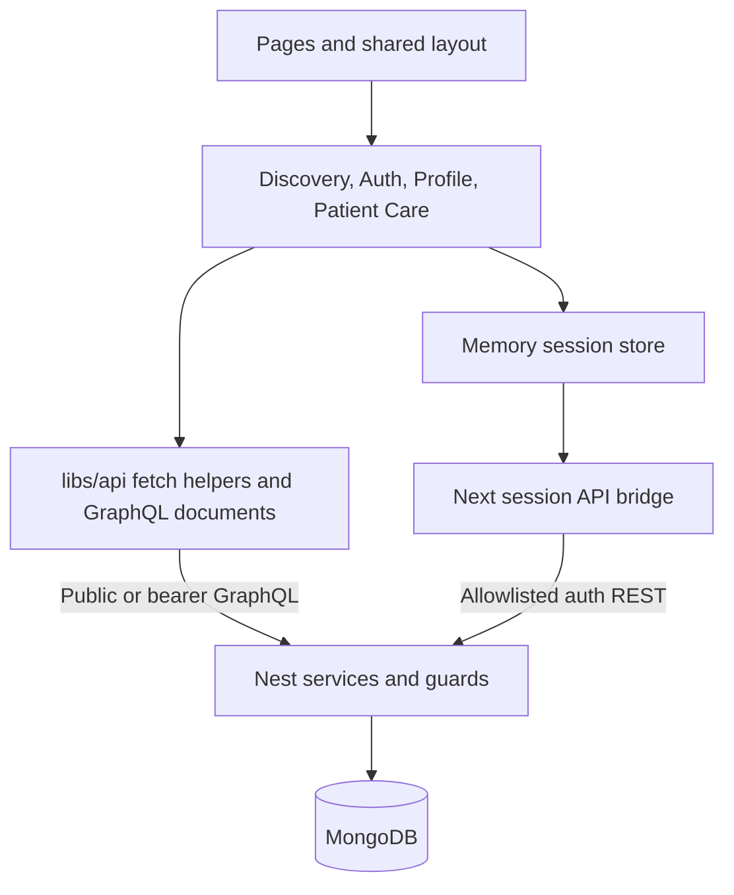
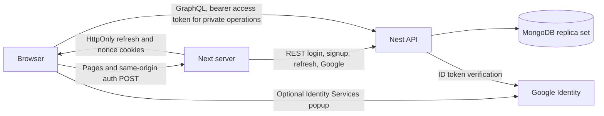

# Next.js architecture

Updated October 31, 2026 for patient booking/waitlist Step 9. This document covers
the Next application; [backend architecture](architecture-backend.md) owns API,
persistence, migration, workers and release gates.

## Responsibilities and interfaces

The Pages Router uses Next 16.4.1, React 19.3.1, MUI 9, TypeScript and shared SCSS.
Route files compose `components/booking/`, existing discovery/auth/profile features,
and shared layout. `_app.tsx` initializes the in-memory session store and theme;
`_document.tsx` supplies Emotion SSR styles. Static pages contain public shells,
not patient records. Patient data is fetched only after session restoration.

`apollo/user/booking.ts` describes slots, paginated owned lists/details, booking,
enrollment, cancellation, withdrawal and atomic replacement. `libs/api/booking.ts`
adds the current access token, omits cookies, disables caching, handles HTTP-200
GraphQL errors, and never automatically retries writes. `libs/booking.ts` handles
presentation/structured conflict normalization; server responses remain authoritative.
`BookingCalendar` adapts the MediBridge month grid with accessible day buttons and
clinic-local date-only arithmetic in `libs/booking-calendar.ts`. It emits the
selected date to BookPage; it neither fetches slots nor assumes weekends are closed.
`ActionDialog` owns review, explicit consent/forfeit acknowledgement, stale-source
preflight, and read reconciliation. Both originals and targets are displayed.
`PatientGate` restricts the UI to USER accounts and unmounts private state at sign-out
or identity changes. Nest guards enforce actual access and patient-derived ownership.

Public discovery uses `getDoctors` (maximum 100) and public `getMember` for clinics;
clinic-specific lists filter those public doctors. Public metadata lookup failures
fall back to identifiers and labeled UTC time; no private profile endpoint is used.
`myProfile` and update/image operations remain separate authenticated helpers.

## Sessions and deployment

`pages/api/session/[action].ts` delegates to `libs/server/session-proxy.ts`.
Only same-origin JSON POSTs with the custom session header are accepted. The bridge
forwards allowlisted inputs and only the required Google nonce cookie. It returns
allowlisted member fields/access tokens; refresh tokens stay in HttpOnly,
SameSite=Lax cookies with `/api/session` path and Secure in production. All bridge
responses have no-store/no-cache headers. No direct database access exists in Next.

The memory store restores/refreshes access tokens. `libs/api/session.ts` serializes
session operations and uses Web Locks when supported; BroadcastChannel events
carry no credentials. The bridge bounds concurrent-refresh coalescing to one
process and briefly retains successful rotation responses. Cookies are not backend
revocation: logout clears local state/cookies, and network failure can prevent
cookie removal. Nest owns fixed session lifetime and credential invalidation.

Deploy a Next server and Nest API behind HTTPS. `NEXT_PUBLIC_GRAPHQL_URL` and public
asset/Google configuration are browser-visible build inputs. Server `API_URL` may
use a private reachable Nest origin; never put secrets in public variables. The
reverse proxy must preserve the trusted public Host/Origin. API CORS must permit
the frontend origin for bearer GraphQL. No patient data is serialized into page
props or persisted in browser storage/shared Apollo caches.

## Verified behavior and remaining concerns

Local Chrome exercised real Nest services with a disposable replica set and
synthetic patients/clinic/doctors. All four replacement directions, both conflict
choices, failed-target original preservation, booking, withdrawal/details, cutoff,
reload refresh and reload-after-sign-out passed. A controlled proxy discarded
committed booking/cancellation responses; owned reads reconciled them without
repeating mutations. Mobile 390px layout and keyboard review/confirmation passed.
Typecheck, production build, 26 focused Node tests, and 18 real-schema operation
validations passed. The final build excludes fixture API URLs. This is not evidence
of production deployment or real Google sign-in.

- Discovery is limited to the first 100 approved doctors and their clinics.
  Complete clinic/doctor pagination needs a future backend public directory contract.
- Refresh coalescing is process-local; Web Locks coordinate supporting browsers.
  Multi-instance deployments and browsers without those locks need separate
  concurrency verification before claiming equivalent session reliability.
- Ambiguous writes have no client idempotency key. The UI safely checks owned state
  and blocks unresolved local changes; it cannot prove failure from an empty read.
  A future server request-ID contract could improve recovery without unsafe replay.

Google account login, production TLS/proxy/session concurrency, natural timed access
expiry, and live profile storage/password flows remain unverified. Step 10 clinic
calendar/live UI and Step 11 notifications are pending. Automatic promotion remains
blocked by the backend patient-visible notification delivery gate; this step does
not activate workers, change flags, or migrate an application database.
