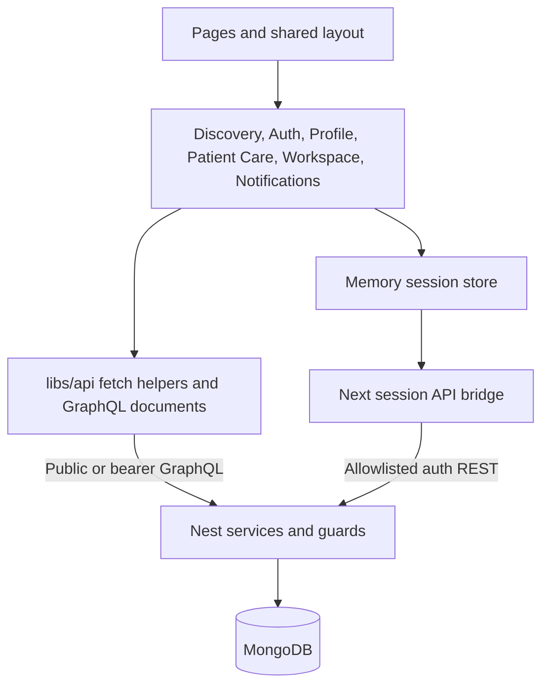
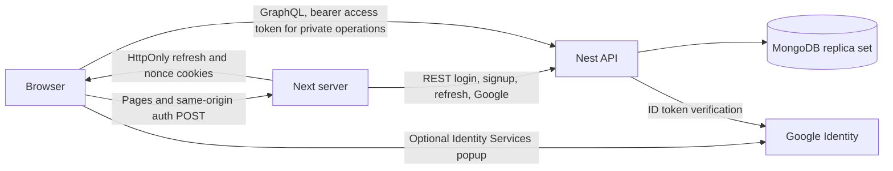

# Next.js architecture

Updated November 1, 2026 for patient booking/waitlist Step 9, staff workspace Step 10, and patient notifications Step 11. This document covers
the Next application; [backend architecture](architecture-backend.md) owns API,
persistence, migration, workers and release gates.

## Responsibilities and interfaces

The Pages Router uses Next 16.4.1, React 19.3.1, MUI 9, TypeScript and shared SCSS.
Route files compose `components/booking/`, existing discovery/auth/profile features,
and shared layout. `_app.tsx` initializes the in-memory session store and theme;
`_document.tsx` supplies Emotion SSR styles. Static pages contain public shells,
not patient records. Patient data is fetched only after session restoration.

`apollo/user/booking.ts` describes slots, paginated owned lists/details, booking,
enrollment, cancellation, withdrawal and atomic replacement. `libs/api/booking.ts`
adds the current access token, omits cookies, disables caching, handles HTTP-200
GraphQL errors, and never automatically retries writes. `libs/booking.ts` handles
presentation/structured conflict normalization; server responses remain authoritative.
`BookingCalendar` adapts the MediBridge month grid with accessible day buttons and
clinic-local date-only arithmetic in `libs/booking-calendar.ts`. It emits the
selected date to BookPage; it neither fetches slots nor assumes weekends are closed.
`ActionDialog` owns review, explicit consent/forfeit acknowledgement, stale-source
preflight, and read reconciliation. Both originals and targets are displayed.
`PatientGate` restricts the UI to USER accounts and unmounts private state at sign-out
or identity changes. Nest guards enforce actual access and patient-derived ownership.

Public discovery uses `getDoctors` (maximum 100) and public `getMember` for clinics;
clinic-specific lists filter those public doctors. Public metadata lookup failures
fall back to identifiers and labeled UTC time; no private profile endpoint is used.
`myProfile` and update/image operations remain separate authenticated helpers.

## Sessions and deployment

`pages/api/session/[action].ts` delegates to `libs/server/session-proxy.ts`.
Only same-origin JSON POSTs with the custom session header are accepted. The bridge
forwards allowlisted inputs and only the required Google nonce cookie. It returns
allowlisted member fields/access tokens; refresh tokens stay in HttpOnly,
SameSite=Lax cookies with `/api/session` path and Secure in production. All bridge
responses have no-store/no-cache headers. No direct database access exists in Next.

The memory store restores/refreshes access tokens. `libs/api/session.ts` serializes
session operations and uses Web Locks when supported; BroadcastChannel events
carry no credentials. The bridge bounds concurrent-refresh coalescing to one
process and briefly retains successful rotation responses. Cookies are not backend
revocation: logout clears local state/cookies, and network failure can prevent
cookie removal. Nest owns fixed session lifetime and credential invalidation.

Deploy a Next server and Nest API behind HTTPS. `NEXT_PUBLIC_GRAPHQL_URL` and public
asset/Google configuration are browser-visible build inputs. Server `API_URL` may
use a private reachable Nest origin; never put secrets in public variables. The
reverse proxy must preserve the trusted public Host/Origin. API CORS must permit
the frontend origin for bearer GraphQL. No patient data is serialized into page
props or persisted in browser storage/shared Apollo caches.

## Verified behavior and remaining concerns

Local Chrome exercised real Nest services with a disposable replica set and
synthetic patients/clinic/doctors. All four replacement directions, both conflict
choices, failed-target original preservation, booking, withdrawal/details, cutoff,
reload refresh and reload-after-sign-out passed. A controlled proxy discarded
committed booking/cancellation responses; owned reads reconciled them without
repeating mutations. Mobile 390px layout and keyboard review/confirmation passed.
Typecheck, production build, 26 focused Node tests, and 18 real-schema operation
validations passed. The final build excludes fixture API URLs. This is not evidence
of production deployment or real Google sign-in.

- Discovery is limited to the first 100 approved doctors and their clinics.
  Complete clinic/doctor pagination needs a future backend public directory contract.
- Refresh coalescing is process-local; Web Locks coordinate supporting browsers.
  Multi-instance deployments and browsers without those locks need separate
  concurrency verification before claiming equivalent session reliability.
- Ambiguous writes have no client idempotency key. The UI safely checks owned state
  and blocks unresolved local changes; it cannot prove failure from an empty read.
  A future server request-ID contract could improve recovery without unsafe replay.

Google account login, production TLS/proxy/session concurrency, natural timed access
expiry, and live profile storage/password flows remain unverified. Step 12
rollout remains pending; Step 11 local notification evidence is recorded below. Automatic promotion remains
blocked by the backend patient-visible notification delivery gate; this step does
not activate workers, change flags, or migrate an application database.

## Staff workspace and live calendar

`pages/workspace.tsx` composes `components/workspace/WorkspacePage.tsx`. Its guarded
client subtree is keyed by signed-in identity, so role changes/sign-out unmount
private state. Profiles supply clinic/timezone context; CLINIC accounts load owned
`myClinicDoctors`. DOCTOR accounts have a read-only self calendar. Client role gates
are presentation only: Nest guards and principal-derived scope enforce all access.
The existing session bridge is unchanged; `/workspace` is an allowlisted auth return.

`LiveCalendar` renders day/seven-day views and fresh details. `useLiveCalendar`
performs sequential, abortable revision polling, pauses on hidden/offline tabs,
marks stale state and backs off after failures, and fully resyncs on reconnect.
`libs/api/workspace.ts` reuses the booking no-store/bearer/error transport. Its
snapshot loader buffers at most 50 pages, binds every continuation to the first
revision, discards inconsistent partial reads, and retries read conflicts at most
three times. IDs are deduplicated before publishing. Scope/window changes never
merge old snapshots. Forbidden/expired sessions clear the private view.

`libs/workspace.ts` maps clinic-local dates into exact UTC overlap windows, including
23/25-hour DST dates and midnight gaps; no browser-local midnight assumption is
used. Compact cards are grouped/displayed in the workspace timezone; details label
their clinic timezone. Authoritative timezone-context changes resync the window.

`TeamSchedules` owns affiliation reviews and acknowledged complete schedule drafts.
`StaffBooking` uses public slots plus patient-ID validation, with Nest deriving clinic
identity. `WorkspaceReview` requires a single explicit mutation confirmation and
keeps uncertain outcomes in read-check mode. Appointment/status checks reread owned
records; staff creation compares owned target IDs from before/after the request.
No mutation retry is automatic. No direct database access exists in production Next.
The current API cannot read saved schedule configuration, so blank drafts never
masquerade as current settings, and unknown schedule writes remain locally blocked.

No new real-time server or dependency was added. The existing deployment diagram
still applies: revision requests use authenticated browser→Nest GraphQL, never an
assumed SSE/WebSocket channel. Next renders only public static shells, with no
private calendar data in serialized props/shared caches/browser storage.

Step 10 verification: 41 Node tests, typecheck/build and 26 actual-schema operations
passed. Local Chrome with real Nest/disposable MongoDB verified staff and doctor
flows, patient denial, schedule protection, mobile/keyboard details, dropped-response
staff reconciliation and outage recovery including online/promoted bookings without
duplicates. Promotion ran only via a fixture-local worker enable hook; the release
gate remains closed. Foreign-clinic reads returned no records and foreign-doctor
scope was forbidden. The real frontend loader handled 150 records and a committed
between-page revision change by restarting without duplicates. Proxy outages were
controlled test faults; production transport/load and full OS-offline behavior were
not exercised. Backend, Vite, application data and deployment were unchanged.

## Patient-visible IN_APP notification delivery

`pages/notifications.tsx` composes `components/notifications/NotificationsPage.tsx`
inside the existing identity-keyed PatientGate. `NotificationDetail` separates
recorded notice content from a fresh `notificationContext` response; it never
infers current confirmation/availability from historical text. Context polls and
list reads use the existing authenticated no-store GraphQL transport. The generic
private polling helper in `libs/hooks/useNotifications.ts` serves these two reads,
pauses when hidden/offline, aborts old scope requests and retries transient errors.
Current target actions disappear while a fresh check is unavailable. No new server,
provider, subscription or deployment boundary was introduced.

`libs/api/notification.ts` owns list/detail/context/mark-read transport and bounded
page buffering/deduplication. `libs/notification.ts` owns neutral historical titles,
current-state labels and allowlisted internal target links. Explicit read mutation
results reconcile through owned reads after ambiguity; no automatic write replay
or mark-on-open exists. Unread filtering affects reads only, never delivery. No
public count of another patient's notices or operator delivery aggregates is fetched.

Owned care detail query links bypass list filters via authenticated fresh lookups.
Booking links carry public exact-target fields and prefill only after current slots
are read, including the recorded specialty and clinic-local date. Actual booking
still requires the existing confirmation and server conflict enforcement. A filled
waitlist can link to its current owned appointment; canceled history remains visible
as canceled. Public metadata may fall back to identifiers/labeled UTC, not a false
clinic timezone. Static shells contain no patient data, and sign-out unmounts state.

November 1 verification: 50 Node tests, typecheck/production build, 30 actual-schema
operations, and real Nest/disposable MongoDB Chrome journeys passed. A real worker
promotion generated a required notice; controlled delivery failure/retry/replay
reached the inbox once while preserving one booking/read state. Browser evidence
covers canceled/occupied contexts, explicit and uncertain read handling, exact-slot
manual fulfillment, owned target links, mobile/keyboard behavior and read-outage
suppression/recovery. Foreign-patient context was denied. Historical cutoff fixture
records included matching versioned ledgers. Workers were invoked with fixture-only
enable hooks; no source flag/release gate, application database or provider changed.

Configured delivery is IN_APP; email/SMS/OS push are not claimed. Backend Step 12 replaces the hard promotion block with explicit activation
prerequisites; the normal-worker local pilot is recorded below.
Production transport/workers/load and full OS-offline simulation remain unverified.

## Step 12 local acceptance — November 1

No frontend boundary or feature code changed. The existing booking, workspace and
notification transports passed a normal-worker real-Nest/MongoDB browser pilot:
patient join → clinic cancellation → native FIFO allocation → live clinic calendar
→ patient notice/current confirmed appointment → explicit read. Waitlist presentation
uses the backend's corrected real promotion flag. Next typecheck, 50 tests and
production build passed. Google signup is owner-confirmed. Production activation,
proxy/load/SLA and external delivery remain separate. Operational procedures live
in `backend/BOOKING_ROLLOUT.md` on the backend branch; integrate that branch before
using its new activation configuration. Earlier pending Step 12 notes describe
historical verification limits and are superseded by this local acceptance.
