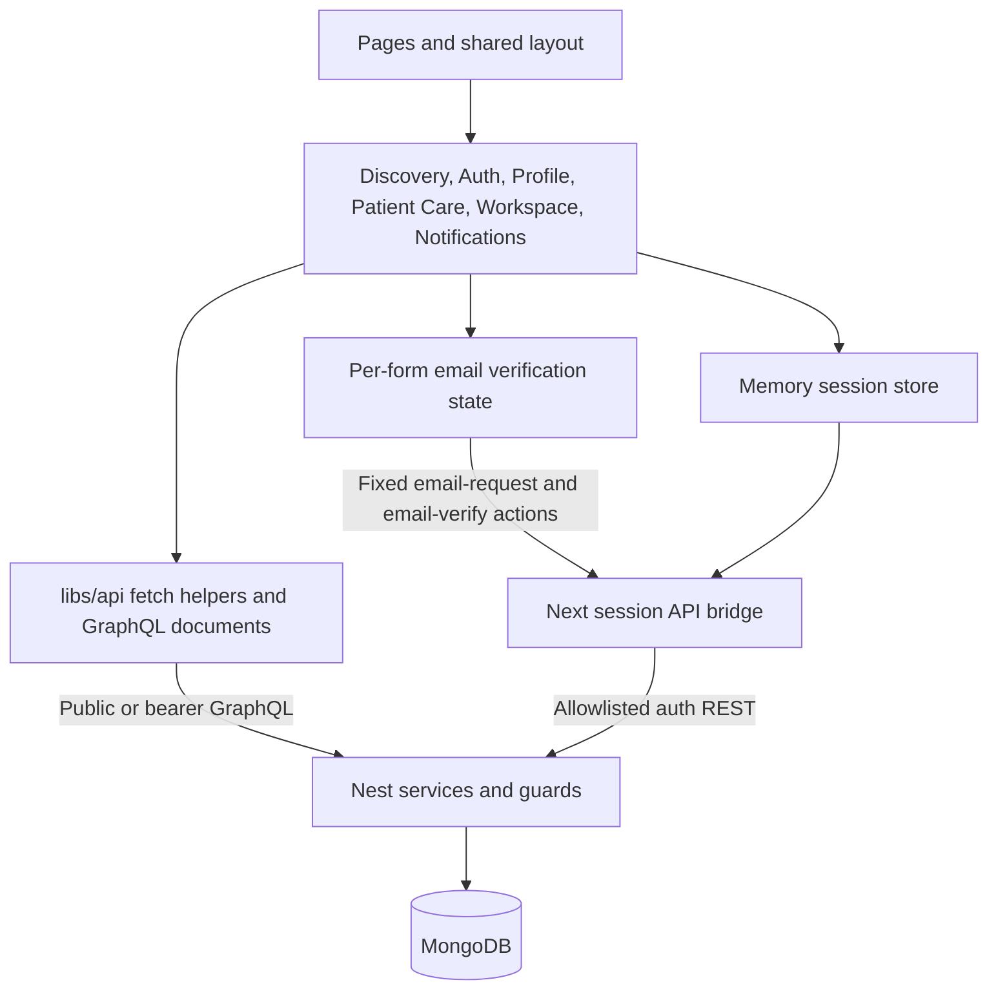
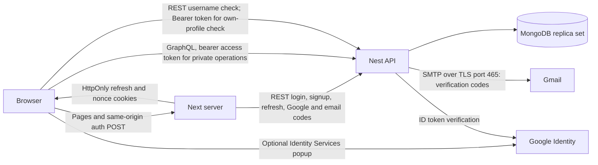

# Next.js architecture

Updated November 13, 2026 for FI-08 email verification final acceptance. Earlier patient booking,
staff workspace and notification records remain below. This document covers
the Next application; [backend architecture](architecture-backend.md) owns API,
persistence, migration, workers and release gates.

## Responsibilities and interfaces

The Pages Router uses Next 16.4.1, React 19.3.1, MUI 9, TypeScript and shared SCSS.
Route files compose `components/booking/`, existing discovery/auth/profile features,
and shared layout. `_app.tsx` initializes the in-memory session store and theme;
`_document.tsx` supplies Emotion SSR styles. Static pages contain public shells,
not patient records. Patient data is fetched only after session restoration.

`apollo/user/booking.ts` describes slots, paginated owned lists/details, booking,
enrollment, cancellation, withdrawal and atomic replacement. `libs/api/booking.ts`
adds the current access token, omits cookies, disables caching, handles HTTP-200
GraphQL errors, and never automatically retries writes. `libs/booking.ts` handles
presentation/structured conflict normalization; server responses remain authoritative.
`BookingCalendar` adapts the MediBridge month grid with accessible day buttons and
clinic-local date-only arithmetic in `libs/booking-calendar.ts`. It emits the
selected date to BookPage; it neither fetches slots nor assumes weekends are closed.
`ActionDialog` owns review, explicit consent/forfeit acknowledgement, stale-source
preflight, and read reconciliation. Both originals and targets are displayed.
`PatientGate` restricts the UI to USER accounts and unmounts private state at sign-out
or identity changes. Nest guards enforce actual access and patient-derived ownership.

The `/doctors` and `/clinics` directories use the public search/suggestion queries
as detailed below. Homepage and ordinary booking clinic choices retain `getDoctors`
(maximum100) and public `getMember`. Explicit clinic doctor reads now use public
`getClinicDoctors` (maximum100 per clinic). Public metadata lookup failures
fall back to identifiers and labeled UTC time; no private profile endpoint is used.
`myProfile` and update/image operations remain separate authenticated helpers.

## Doctor directory search — November 5, 2026

`pages/doctors.tsx` composes `components/doctors/DoctorsPage.tsx`, retaining the
existing DoctorCard and booking links. The directory now reads server-filtered
results instead of filtering a capped `getDoctors` array. Step5 below extracts the
shared directory component and adds the clinic screen. Homepage discovery retains
its existing capped clinic transport.

- `apollo/user/directory.ts` defines executable `SearchDoctors` and
  `SuggestDoctorNames` documents for the delivered Nest contracts. The public
  `libs/api/directory.ts` adapter uses fetch with omitted credentials, no-store,
  abort propagation and a10s client timeout. HTTP failures and HTTP200 GraphQL
  errors become safe messages. Pages contain12 entries and the actual server total;
  suggestion responses contain at most eight strings. Backend filters, eligibility,
  projection, collation and query bounds remain authoritative.
- `libs/directory.ts` owns the UI enum lists, URL parsing/serialization and
  DirectoryNavigation. Supported URL keys are `name`, `city`, `specialty`, `sort`
  and `page`. Name is trimmed/bounded to100 characters; invalid/repeated values use
  safe defaults, cities/specialties are allowlisted and page is1–1000. Sort defaults
  to NAME_ASC. URLSearchParams encodes names; new URLs omit empty/default values.
- `useDirectoryLocation` in `libs/hooks/useDirectory.ts` connects the store to the
  installed Pages Router. Restoration waits for router readiness and follows asPath,
  including refresh/shared links and Back/Forward. Draft text commits after300ms
  using router.replace; Enter, suggestions and deliberate filter/sort/page actions
  use router.push. Filter/name/sort changes reset page1; pagination changes only page.
  Clearing resets everything. Route-start cancels pending typing, and rapid choices
  compose against the pending route. New typing during an own route transition is
  preserved when that transition completes.
- Result and suggestion effects abort obsolete reads and key displayed state to the
  matching URL/draft. Shared directoryRead also ignores late successes/failures from
  transports that finish after cancellation. Main search has independent loading,
  retry, error and empty/out-of-range states; old cards are hidden while navigating.
- MUI9 Autocomplete renders a free-text combobox with server-provided options and
  no extra client filtering. Requests wait for two trimmed characters and a300ms
  debounce, using current city/specialty. Selecting a name submits page1. Enter can
  submit arbitrary text, Escape closes suggestions, and suggestion failure leaves
  ordinary search available. Labels, live result counts and responsive controls are
  included. No IDs, highlighted option or popup state are stored in URLs.

Example: `/doctors?name=Kim&city=SEOUL&specialty=DENTIST&sort=NAME_DESC&page=2`.

Verification:81 Node tests cover existing flows and16 new URL/navigation/transport/
stale-response cases; TypeScript and an isolated production build pass. Actual
frontend adapters/documents were checked against compiled Nest and owned disposable
MongoDB:125 matching doctors,12/page, both sorts/page2, authoritative city, combined
filters, literal Unicode, username exclusion, empty pages/totals, suggestions and
independent503 recovery passed. Native Chrome confirmed the combined deep link's
controls/count/cards and a pagination URL/request change. Further native control
was interrupted by active Chrome use; Safari control timed out. Keyboard suggestion
selection/Escape, real Back/Forward, error/retry UI and mobile acceptance remain
unverified in a browser. Automated history-command/timer tests do not establish those
browser interactions. No deployment or production-data claims are made.

## Clinic search and shared directory — November 5, 2026

`components/directory/DirectoryPage.tsx` now owns the filter form, accessible MUI
name combobox, URL/navigation hooks, result announcements, loading/error/retry/empty
states and centered pagination for both directories. Doctor/clinic pages compose
that shared view with their existing cards. `_directory.scss` replaces duplicate
doctor/clinic page styles and retains the requested centered pagination. No second
router, request cache or dependency was introduced.

- `apollo/user/directory.ts` adds executable `SearchClinics` and `SuggestClinicNames`
  documents. `libs/api/directory.ts` shares bounded public transport/validation and
  exports doctor/clinic adapters. `useDirectoryResults` and `useDirectorySuggestions`
  take an explicit directory kind, included in response keys so clinic data cannot
  appear as doctor results. Both reuse the existing URL state machine, debounces,
  history semantics, filters, page resets and cancellation guards described above.
- `/clinics` sends clinic-name/city/specialty filters to Nest and displays server
  totals/pages. It no longer derives clinics from a global doctor list or searches
  addresses/usernames locally. Clinics without doctors can appear without specialty;
  specialty eligibility and distinct clinic counts remain server responsibilities.
- ClinicsPage retains ClinicCard/DoctorsDialog and owns selected-clinic state. Opening
  or closing the dialog leaves the directory URL unchanged; route-start closes it.
  Existing View times links carry clinicId/doctorId to booking. Returning through the
  browser history restores the clinic directory URL using the same shared hook.
- The dialog and other explicit clinic-doctor reads use public `getClinicDoctors`
  through `fetchMembers(clinicId)`, rather than filtering the first100 global doctors.
  This is necessary for clinics newly discoverable beyond that cap. Existing
  homepage clinic discovery remains unchanged, and booking already resolves explicit
  linked clinics/doctors with public lookups. The per-clinic doctor endpoint still
  caps at100; the dialog labels that bound when reached. No private affiliation API
  or authentication bypass is used.

Verification:TypeScript,89 Node tests and isolated production build pass. Eight
new tests cover clinic adapters/URL return behavior and doctor/clinic static-shell
labels, with the existing doctor/homepage tests retained. Actual adapters against
normal compiled Nest and owned disposable MongoDB verified125 matching clinics,
two eligible doctors each without duplicate totals, both sorts/page2, combined
filters, Unicode literals, username exclusion, empty/out-of-range pages, no-doctor
clinics, eight suggestions, independent503 recovery and a Care112 team absent from
legacy homepage discovery. Doctor search/suggestions and homepage adapter checks
also pass. Chrome displayed the combined page2 clinic deep link with125 results and
correct controls/cards. Further native input returned active-app/no-window errors
or no observable state change. Dialog/booking-return, keyboard autocomplete/history,
error/retry UI and mobile browser acceptance remain unverified; Step6 must distinguish
these outstanding interaction checks from the completed API/automated checks.

## Directory filter polish and combined acceptance — November 5, 2026

Step6 adds removable name/city/specialty/reverse-sort chips to the shared
DirectoryPage. Removing a chip preserves other filters and resets page1; explicit
name removal takes precedence over the pending text draft. Clear filters restores
defaults. Both actions return focus to the name input. City labels explain that
doctor city belongs to the clinic; specialty options use clinical labels while
URLs/API requests retain the existing enums. Empty selectors explicitly show All
cities and All specialties.

Pagination focuses and scrolls to the live result summary after the new read
finishes. Long chips wrap, results reserve loading space, and skeleton motion
respects reduced-motion preferences. Both pages retain centered pagination.

TypeScript,92 tests and an isolated production build with fixture URLs empty pass.
Actual frontend adapters against normal compiled Nest and owned disposable MongoDB
pass for both directories:125 matching records,12/page,both sorts/page2,combined
filters,Unicode literal names,username exclusion,out-of-range totals,eight filtered
suggestions and independent search/suggestion503 recovery. Clinic counts remain
distinct with two matching doctors each; public Care112 team lookup and homepage
regressions pass. Additional delayed real HTTP checks verify obsolete search and
suggestion requests are aborted and only the latest result publishes for both kinds.

Chrome desktop checks pass for doctor autocomplete keyboard selection,refresh,
Back/Forward,name-chip deletion,preserved filters,page reset and pagination-summary
focus. Clinic combined links,page2,doctor-dialog close/focus,booking target IDs and
Back restoration pass. Injected suggestion failure leaves ordinary search usable;
main-search failure hides stale cards and Try again recovers. Clear filters removes
URL parameters and restores name-input focus. The390px clinic top/control layout
has been visually inspected. A follow-up confirms Escape closes clinic suggestions
without changing filters, and mobile clinic cards fit the viewport. Mobile inspection
caught left-aligned wrapped pagination rows; the shared `.MuiPagination-ul` now
centers each row, and the updated isolated production build passes. Final390px
browser rechecks pass for centered wrapped pagination on both pages, doctor controls,
single-column cards and booking links without visible horizontal overflow. The
browser surface recovered after the owner brought the preview forward; earlier
control failures are historical tooling limits. Combined local Step6 acceptance is
complete. These results supersede the corresponding historical Step4/5 gaps above.
Deployment and production-scale performance remain unverified.

## Square photos and upload cropping — November 5, 2026

FI-07/NEXT-B13 is implemented. `components/common/ImageCropper.tsx` uses the reviewed
MediBridge crop/zoom pattern with react-easy-crop6.2.4 and an accessible MUI Dialog.
The fixed square supports pointer/keyboard positioning and labeled zoom. Opening the
cropper creates a temporary object URL; cancelling/unmounting revokes it and keeps
the previous draft. Confirm prepares a local File and preview; My Page's existing
Save changes performs authenticated upload then profile update. No upload happens
on selection or crop confirmation. Pending crop blocks profile submission; errors
keep the confirmed draft available. The shared My Page flow serves all account roles.

`libs/image-crop.ts` validates existing JPEG/PNG/WebP inputs up to10MB, checks crop
bounds, and draws only the selected square into a canvas capped at1024×1024,without
upscaling. JPEG quality0.9 and a white transparency background standardize output.
Decode/canvas/encoding errors remain visible; the original file is never uploaded
as a fallback. Source/cropped preview URLs are cleaned up independently.

Both card styles use1:1,centered cover,including existing/default photos; stored
legacy images are not rewritten. `libs/api/image-url.ts` resolves member images
against the public API origin for both cards and My Page. Browser acceptance found
that previously root-relative uploads incorrectly went to Next and returned404.
Defaults remain local; existing absolute HTTP(S) images remain supported.

The owner explicitly authorized a necessary backend fix discovered by real uploads:
UploadResolver now reflects the Upload scalar as Object via a FileUpload/Promise
union and normalizes it with Promise.resolve. This prevents production ValidationPipe
from trying to instantiate Promise. Schema,authentication,ownership and file rules
remain unchanged; backend and Next changes need separate manual commits.

Verification: Next typecheck,97 tests and final isolated production build pass.
Backend build/full TypeScript,12 upload HTTP tests with production validation and
all222 API tests pass; lint retains the pre-existing config.ts warning. Chrome
verified desktop crop/keyboard zoom and position,cancel/focus/draft preservation,
upload503 preservation,actual clinic and doctor saves and a375px mobile crop dialog.
Read-only inspection of both stored fixture uploads confirms JPEG1024×1024 and the
correct clinic/member targets. The rebuilt public clinic card displays the saved
crop from the API. All data is disposable; deployment/intended production storage
and rewriting legacy images are outside this acceptance.

## Email verification signup — FI-08 Step 4, November 13, 2026

`AuthPage` composes `components/auth/EmailVerification.tsx` beside the email field.
The per-form `EmailVerification` state in `libs/email-verification.ts` is subscribed
through `use-email-verification.ts`, following the existing username-check pattern.
It owns challenge/proof deadlines, request identity, messages and cancellation;
Nest owns email policy, guesses, persistence and atomic proof consumption.

- Send code and Verify email are explicit button actions. Six-digit strings preserve
  leading zeros; labels, one-time-code autocomplete, numeric input hints, keyboard
  focus and polite status messages are included. The small-screen panel stacks its
  controls. Account creation requires both valid proof and username availability.
- Changing the normalized email or form mode cancels obsolete requests and clears
  verification. Revisions also reject stale responses from transports that ignore
  aborts. Request IDs, codes and proof exist only in form memory, with no browser
  storage, serialized page props, URL fields or cross-tab token broadcasts.
- Uncertain delivery exposes Retry send using the same UUID v4. A deliberate
  Send new code/Resend code uses a new UUID and clears prior proof. Existing code
  entry is retained on failure when a prior challenge may still be usable. Absolute
  server-derived deadlines drive cooldowns; interval ticks redraw current remaining
  time and expire proof. Blocked sends do not prevent verification or valid signup.
- `libs/api/email-verification.ts` uses the existing session transport/timeouts.
  The bridge adds only `email-request` → `email-verification/request` and
  `email-verify` → `email-verification/verify`, forwards declared fields, validates
  response shape/duration/opaque-token bounds and returns only challenge/timing or
  proof/timing fields. Neither action calls tokenResult or sets session cookies.
- `email-verification-contract.ts` is a shared public contract without server-only
  imports. Proxy/session/auth error normalization preserves only known reason/status
  pairs and finite retry timing clamped to 1–86400 seconds. Provider payloads and
  arbitrary fields are dropped; no-store, same-origin JSON/header checks and fixed
  upstream URL are preserved. Signup forwards proof while forcing USER and keeps
  the existing exact USERNAME_TAKEN/memberNick marker.
- Correctable signup conflicts preserve unrelated form fields and valid proof.
  Required/invalid proof from Nest clears email authorization and asks for a fresh
  code. Ordinary login guidance remains for an uncertain committed signup response.
  Only completed signup calls the established session store.

The current Nest peer for all proxied clients is Next's server. Their code-request
and confirmation IP budgets are shared; changing an untrusted forwarded-IP header
does not grant another budget. Durable email escalation remains backend-owned.
Configure backend verification storage and SMTP before a coordinated release.

Verification: typecheck, frontend tests and isolated production build results are
recorded in the Next delivery log. Real Next proxy → compiled Nest → disposable
replica-set HTTP checks covered field/error contracts, delivery rejection and
ambiguous-send recovery, expired proof, persisted signup details, login cookies and
shared upstream IP limits. Native Chrome passed wrong-code correction, email-edit
invalidation, keyboard code confirmation, username-conflict draft/proof preservation
and successful signup, plus a 390px layout check. SMTP was stubbed and no application
database or live provider was used. FI-08 Step 5's real inbox/browser acceptance
subsequently completed as recorded below. The shared backend plan is preserved under the Next
worktree's protected-backend rule; this section records Step 4 delivery.

## Sessions and deployment

`pages/api/session/[action].ts` delegates to `libs/server/session-proxy.ts`.
Only same-origin JSON POSTs with the custom session header are accepted. The bridge
forwards allowlisted inputs and only the required Google nonce cookie. It returns
allowlisted member fields/access tokens; refresh tokens stay in HttpOnly,
SameSite=Lax cookies with `/api/session` path and Secure in production. All bridge
responses have no-store/no-cache headers. No direct database access exists in Next.

The memory store restores/refreshes access tokens. `libs/api/session.ts` serializes
session operations and uses Web Locks when supported; BroadcastChannel events
carry no credentials. The bridge bounds concurrent-refresh coalescing to one
process and briefly retains successful rotation responses. Cookies are not backend
revocation: logout clears local state/cookies, and network failure can prevent
cookie removal. Nest owns fixed session lifetime and credential invalidation.

Deploy a Next server and Nest API behind HTTPS. `NEXT_PUBLIC_GRAPHQL_URL` and public
asset/Google configuration are browser-visible build inputs. Server `API_URL` may
use a private reachable Nest origin; never put secrets in public variables. The
reverse proxy must preserve the trusted public Host/Origin. API CORS must permit
the frontend origin for bearer GraphQL. No patient data is serialized into page
props or persisted in browser storage/shared Apollo caches.

## Verified behavior and remaining concerns

Local Chrome exercised real Nest services with a disposable replica set and
synthetic patients/clinic/doctors. All four replacement directions, both conflict
choices, failed-target original preservation, booking, withdrawal/details, cutoff,
reload refresh and reload-after-sign-out passed. A controlled proxy discarded
committed booking/cancellation responses; owned reads reconciled them without
repeating mutations. Mobile 390px layout and keyboard review/confirmation passed.
Typecheck, production build, 26 focused Node tests, and 18 real-schema operation
validations passed. The final build excludes fixture API URLs. This is not evidence
of production deployment or real Google sign-in.

- Homepage/ordinary booking clinic choices still use the first100 approved doctors
  and their clinics. Both standalone directories have server pagination; explicit
  clinic-doctor lists use their own public endpoint, capped at100 per clinic.
- Refresh coalescing is process-local; Web Locks coordinate supporting browsers.
  Multi-instance deployments and browsers without those locks need separate
  concurrency verification before claiming equivalent session reliability.
- Ambiguous writes have no client idempotency key. The UI safely checks owned state
  and blocks unresolved local changes; it cannot prove failure from an empty read.
  A future server request-ID contract could improve recovery without unsafe replay.

Google account login, production TLS/proxy/session concurrency, natural timed access
expiry, and live profile storage/password flows remain unverified. Step 12
rollout remains pending; Step 11 local notification evidence is recorded below. Automatic promotion remains
blocked by the backend patient-visible notification delivery gate; this step does
not activate workers, change flags, or migrate an application database.

## Staff workspace and live calendar

`pages/workspace.tsx` composes `components/workspace/WorkspacePage.tsx`. Its guarded
client subtree is keyed by signed-in identity, so role changes/sign-out unmount
private state. Profiles supply clinic/timezone context; CLINIC accounts load owned
`myClinicDoctors`. DOCTOR accounts have a read-only self calendar. Client role gates
are presentation only: Nest guards and principal-derived scope enforce all access.
The existing session bridge is unchanged; `/workspace` is an allowlisted auth return.

`LiveCalendar` renders day/seven-day views and fresh details. `useLiveCalendar`
performs sequential, abortable revision polling, pauses on hidden/offline tabs,
marks stale state and backs off after failures, and fully resyncs on reconnect.
`libs/api/workspace.ts` reuses the booking no-store/bearer/error transport. Its
snapshot loader buffers at most 50 pages, binds every continuation to the first
revision, discards inconsistent partial reads, and retries read conflicts at most
three times. IDs are deduplicated before publishing. Scope/window changes never
merge old snapshots. Forbidden/expired sessions clear the private view.

`libs/workspace.ts` maps clinic-local dates into exact UTC overlap windows, including
23/25-hour DST dates and midnight gaps; no browser-local midnight assumption is
used. Compact cards are grouped/displayed in the workspace timezone; details label
their clinic timezone. Authoritative timezone-context changes resync the window.

`TeamSchedules` owns affiliation reviews and acknowledged complete schedule drafts.
`StaffBooking` uses public slots plus patient-ID validation, with Nest deriving clinic
identity. `WorkspaceReview` requires a single explicit mutation confirmation and
keeps uncertain outcomes in read-check mode. Appointment/status checks reread owned
records; staff creation compares owned target IDs from before/after the request.
No mutation retry is automatic. No direct database access exists in production Next.
The current API cannot read saved schedule configuration, so blank drafts never
masquerade as current settings, and unknown schedule writes remain locally blocked.

No new real-time server or dependency was added. The existing deployment diagram
still applies: revision requests use authenticated browser→Nest GraphQL, never an
assumed SSE/WebSocket channel. Next renders only public static shells, with no
private calendar data in serialized props/shared caches/browser storage.

Step 10 verification: 41 Node tests, typecheck/build and 26 actual-schema operations
passed. Local Chrome with real Nest/disposable MongoDB verified staff and doctor
flows, patient denial, schedule protection, mobile/keyboard details, dropped-response
staff reconciliation and outage recovery including online/promoted bookings without
duplicates. Promotion ran only via a fixture-local worker enable hook; the release
gate remains closed. Foreign-clinic reads returned no records and foreign-doctor
scope was forbidden. The real frontend loader handled 150 records and a committed
between-page revision change by restarting without duplicates. Proxy outages were
controlled test faults; production transport/load and full OS-offline behavior were
not exercised. Backend, Vite, application data and deployment were unchanged.

## Patient-visible IN_APP notification delivery

`pages/notifications.tsx` composes `components/notifications/NotificationsPage.tsx`
inside the existing identity-keyed PatientGate. `NotificationDetail` separates
recorded notice content from a fresh `notificationContext` response; it never
infers current confirmation/availability from historical text. Context polls and
list reads use the existing authenticated no-store GraphQL transport. The generic
private polling helper in `libs/hooks/useNotifications.ts` serves these two reads,
pauses when hidden/offline, aborts old scope requests and retries transient errors.
Current target actions disappear while a fresh check is unavailable. No new server,
provider, subscription or deployment boundary was introduced.

`libs/api/notification.ts` owns list/detail/context/mark-read transport and bounded
page buffering/deduplication. `libs/notification.ts` owns neutral historical titles,
current-state labels and allowlisted internal target links. Explicit read mutation
results reconcile through owned reads after ambiguity; no automatic write replay
or mark-on-open exists. Unread filtering affects reads only, never delivery. No
public count of another patient's notices or operator delivery aggregates is fetched.

Owned care detail query links bypass list filters via authenticated fresh lookups.
Booking links carry public exact-target fields and prefill only after current slots
are read, including the recorded specialty and clinic-local date. Actual booking
still requires the existing confirmation and server conflict enforcement. A filled
waitlist can link to its current owned appointment; canceled history remains visible
as canceled. Public metadata may fall back to identifiers/labeled UTC, not a false
clinic timezone. Static shells contain no patient data, and sign-out unmounts state.

November 1 verification: 50 Node tests, typecheck/production build, 30 actual-schema
operations, and real Nest/disposable MongoDB Chrome journeys passed. A real worker
promotion generated a required notice; controlled delivery failure/retry/replay
reached the inbox once while preserving one booking/read state. Browser evidence
covers canceled/occupied contexts, explicit and uncertain read handling, exact-slot
manual fulfillment, owned target links, mobile/keyboard behavior and read-outage
suppression/recovery. Foreign-patient context was denied. Historical cutoff fixture
records included matching versioned ledgers. Workers were invoked with fixture-only
enable hooks; no source flag/release gate, application database or provider changed.

Configured delivery is IN_APP; email/SMS/OS push are not claimed. Backend Step 12 replaces the hard promotion block with explicit activation
prerequisites; the normal-worker local pilot is recorded below.
Production transport/workers/load and full OS-offline simulation remain unverified.

## Step 12 local acceptance — November 1

No frontend boundary or feature code changed. The existing booking, workspace and
notification transports passed a normal-worker real-Nest/MongoDB browser pilot:
patient join → clinic cancellation → native FIFO allocation → live clinic calendar
→ patient notice/current confirmed appointment → explicit read. Waitlist presentation
uses the backend's corrected real promotion flag. Next typecheck, 50 tests and
production build passed. Google signup is owner-confirmed. Production activation,
proxy/load/SLA and external delivery remain separate. Operational procedures live
in `backend/BOOKING_ROLLOUT.md` on the backend branch; integrate that branch before
using its new activation configuration. Earlier pending Step 12 notes describe
historical verification limits and are superseded by this local acceptance.

## Username presentation and validation

`libs/username.ts` supplies the shared client rule for signup and changed profile
usernames: 6–40 English letters, numbers, or `_ # $ % ! & ?`, with surrounding
whitespace trimmed and display capitalization preserved. The API remains responsible
for case-insensitive uniqueness. Full name is separate and is not restricted to the
username character set. Unchanged legacy usernames do not block unrelated edits.

`components/auth/UsernameField.tsx` renders the fixed, non-editable `@` prefix outside
the input value in signup and My Page. Drafts, session data and `memberNick` API
payloads remain unprefixed. Public/workspace fallback names use `displayUsername`;
full names and clinic names retain their normal display.

The Check button uses `libs/api/username.ts`: signup calls the public
`POST /member/username/availability`, while profile editing calls `/me` with the
current Bearer token. Requests omit cookies and caches and send raw, trimmed
`memberNick`. A per-form `UsernameCheck` invalidates results on edits, cancellation
and identity/mode changes; request revisions discard late responses. New/changed
usernames require a successful check, while unchanged usernames allow unrelated
profile edits. Available is advisory: Nest and the unique database index still
resolve competing writes. Checking, taken, invalid and error states are distinct.

Signup conflicts travel through the same-origin session bridge. It forwards only
the exact `USERNAME_TAKEN`/`memberNick` pair on signup HTTP409; other error payloads
remain sanitized. The profile helper recognizes the same allowlisted pair on a
GraphQL CONFLICT. Both forms show the conflict inline and preserve other drafts.
Chrome checks against a synthetic API cover the interaction; complete updated
backend/Google-provider acceptance remains OAuth-fix Step7.

## FI-08 Step 5 final acceptance — November 13, 2026

Next `0ebc234` and backend `f117f1f` were clean before verification. Next typecheck,
125 tests and a final isolated production build without fixture API URLs pass.
Backend build/full TypeScript/lint and 382 tests (96 unit, 222 API, 46 email
integration, 18 username integration) pass: 507 tests total. The only lint warning
is the pre-existing empty backend config file. Existing Google policy remains
covered automatically; no fresh live Google login was attempted.

After explicit approval for up to two emails, the actual Next signup form requested
one real Gmail code to the configured sender inbox. The owner supplied the received
code; keyboard code confirmation, browser signup, sign-out/login and reload-based
session restoration passed. Read-only disposable MongoDB checks confirmed one
account, one consumed proof, private email verification time, token rotation and
unchanged fixed session expiry. No raw code/token/credentials are retained in records.

Fifteen additional actual Next proxy→Nest→disposable MongoDB requests covered
retry/resend/supersession/binding/replay, signup/login/refresh cookies, expiry and
definitive/ambiguous delivery failure with stubbed synthetic mail, separately from
the live sender-inbox flow. Step 4's 390px/error/draft-preservation evidence remains
applicable. The live run also displayed the corrected countdown without an extra
second. Password saving was declined, the browser signed out and the dedicated
tab closed. The owned runner and disposable MongoDB files were removed.

FI-08 is Completed locally. No application-database setup, environment/dependency
changes, deployment, merge, staging, commit or push occurred. No sprint covers
November 13. The [shared plan](../../backend/EMAIL_VERIFICATION_PLAN.md#coordinated-release-preparation)
records coordinated release prerequisites and deployment/proxy/TLS limits.
